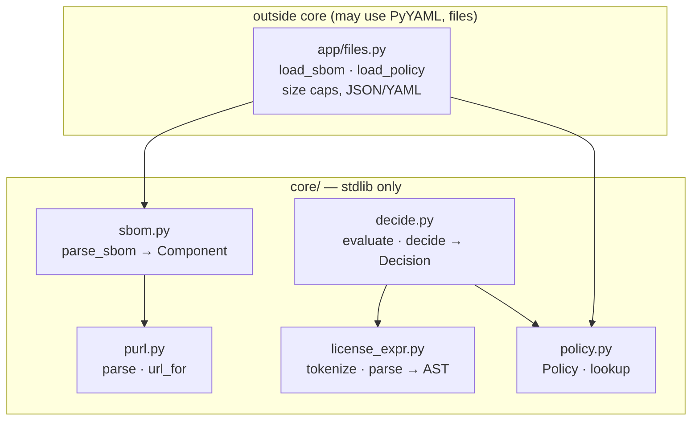

# Design — STORY-001: parse the SBOM and classify against the policy

Spec: `stories/STORY-001.md` (DR-1..DR-8), cases: `stories/STORY-001.cases.yaml` (S1-01..S1-19).
Level: **simple** — one slice, all logic in the pure core, one thin file adapter outside it.

## Modules



```text
            outside core                         core/  (stdlib only)
 ┌──────────────────────────┐      ┌────────────────────────────────────────────────┐
 │ app/files.py             │      │  sbom.py ──► purl.py        (source link)      │
 │  load_sbom   (JSON, cap) │ ───► │     │                                          │
 │  load_policy (YAML, cap) │ ───► │     ▼ Component                                │
 └──────────────────────────┘      │  decide.py ──► license_expr.py  (AST)          │
                                   │     │                                          │
                                   │     └────────► policy.py        (lookup)       │
                                   │     ▼                                          │
                                   │  Decision { verdict, reason, source_url }      │
                                   └────────────────────────────────────────────────┘
```

## File map

```
CREATE core/license_expr.py   tokenizer + recursive-descent parser (OR < AND < WITH < +), ParseError
CREATE core/policy.py         Policy.from_dict, PolicyError, lookup(term) -> verdict | None
CREATE core/purl.py           minimal purl parser (type/namespace/name/version, percent-decoding), url_for
CREATE core/component.py      Component (shared by sbom and decide)
CREATE core/sbom.py           FormatError, parse_sbom (CycloneDX + SPDX), flatten, source link
CREATE core/decide.py         Decision, evaluate(ast, policy), decide(component, policy)
CREATE app/__init__.py, app/files.py   load_sbom(path), load_policy(path): size caps, safe_load, typed errors
CREATE samples/policy.yaml
CREATE samples/sbom.cdx.json  12 real components (pypi/npm/maven/github + 3 Hugging Face models)
CREATE samples/sbom.spdx.json the same 12 components in SPDX 2.3
CREATE tests/story_001/test_cases.py   one test per case id, reading cases.yaml, against the real code
MODIFY scripts/canaries.py    mutations for precedence, OR/AND combining, fail-closed default, WITH inference
```

## Key decisions

- **Parser by hand, not a dependency.** The SPDX grammar is small (four operators, parentheses), the
  core must be stdlib-only (D-01), and a hand parser lets every failure carry its reason
  (`cannot parse: unexpected ')' at 14`). Cost: ~120 lines to test well.
- **The AST keeps `WITH` and `+` as part of the leaf** (`Leaf(id="GPL-2.0-only", plus=False,
  exception="Classpath-exception-2.0")`), and the policy is asked about the leaf's canonical text.
  That is DR-4 made structural: there is no code path that strips an exception or a `+`.
- **Verdicts as an ordered enum** `Reject < Needs review < Allow`: `OR` = `max`, `AND` = `min`. The
  reason of the winning branch is kept, so a `Reject` says which id rejected it.
- **Component identity** = purl when present, else `name@version`. S1-09 compares the two formats
  on that identity.
- **Errors are typed and loud:** `FormatError`, `PolicyError`, `ParseError` (the last one is caught
  by `decide` and becomes `Needs review`, because a bad expression in one component must not stop
  the review of the other components; a bad *file* must stop it).

## Risks and how they are covered

| Risk | Cover |
|---|---|
| Precedence bug (`A AND B OR C`) | S1-12 + canary that swaps AND/OR binding |
| A non-string in the policy (`- no` read as `False`, YAML 1.1) | `load_policy` rejects non-string entries with `PolicyError` naming the entry |
| Huge or hostile input file | size caps in `app/files.py` (SBOM 20 MB, policy 256 KB); deep JSON nesting → `FormatError` |
| Formats disagree on a component | S1-09 compares the two samples on identity, license and AI flag |
| Purl encoding (`%40scope`) | S1-18 row for a scoped npm package |

## Koncepto candidates

None: no domain rule crosses unrelated files. DR-1 (fail closed) spans stories and is guarded by
tests in each story plus a canary, which is enough at this size.
