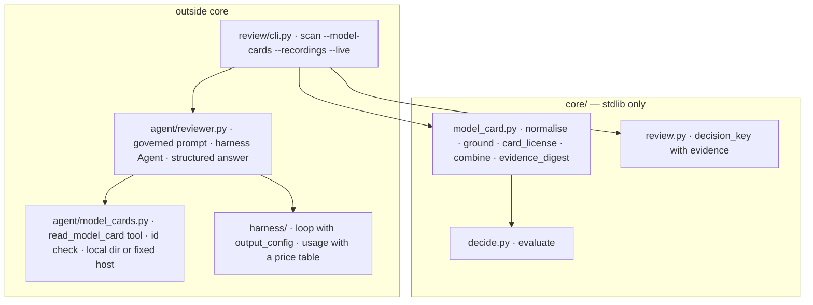

# Design — STORY-002: AI models reviewed against their model cards

Spec: `stories/STORY-002.md` (DR-1..DR-6), cases: `stories/STORY-002.cases.yaml` (S2-01..S2-12).
Level: **medium** — the first package that calls a model (`agent/`), one new pure module in `core/`,
two small harness changes, and an optional path in `review scan`.

## Modules



```text
          outside core                                      core/  (stdlib only)
 ┌──────────────────────────────────────────┐      ┌─────────────────────────────────────────────┐
 │ review/cli.py  scan --model-cards DIR     │      │ model_card.py                               │
 │                --recordings DIR --live    │ ───► │   ground(quote, card, license_id)           │
 │ agent/reviewer.py                         │      │   card_license(id) → SPDX | LicenseRef-<id> │
 │   prompt approved by hash (D-05)          │      │   review_model(component, extraction, card, │
 │   harness Agent, effort, JSON schema      │      │                policy) → Decision (worst)   │
 │ agent/model_cards.py                      │      │   evidence_digest(card, extraction)         │
 │   read_model_card(model_id)  effect=read  │      │ decide.py  evaluate()  (unchanged)          │
 │   org/name only; local dir; fixed host    │      │ review.py  decision_key(+ evidence) (D-08)  │
 └──────────────────────────────────────────┘      └─────────────────────────────────────────────┘
```

## Key decisions

- **The model reads; `core/` decides (D-03).** `agent/reviewer.py` returns the model's raw extraction.
  `core/model_card.py` grounds it against the card **as the code loaded it** (never the text the tool
  returned to the model), maps the id and applies the policy through the existing `evaluate()`.
- **Grounding needs the quote in the card and the id in the quote (DR-1).** Whitespace-normalised,
  case-insensitive substring checks. The second condition is the lesson of the KeysBench review: "is
  in the source" alone accepted a one-word quote. Each restriction is grounded the same way, against
  its own quote; ungrounded ones are dropped and counted (DR-2).
- **Mapping (DR-3).** A table of the Hugging Face license ids that are SPDX licenses (`apache-2.0`,
  `mit`, `bsd-3-clause`, `gpl-3.0`, `agpl-3.0`, `lgpl-2.1`, `mpl-2.0`, `cc-by-4.0`…) to their SPDX ids;
  anything else is `LicenseRef-<id>`, which `decide` already treats as a custom license.
- **Worst of SBOM and card (DR-4).** `review_model` evaluates both and keeps the lower rank; the reason
  carries both, the quote, and the restrictions.
- **Structured answer, validated anyway.** The final turn uses `output_config.format` (JSON schema) so
  the answer parses; the code still validates types and treats anything else as `Needs review`
  (`unreadable model answer`).
- **The tool takes an id, never a URL (D-04).** `^[A-Za-z0-9][A-Za-z0-9._-]{0,95}/[A-Za-z0-9][A-Za-z0-9._-]{0,95}$`,
  no `..`. A format check, so a regex is the right tool. It reads `DIR/<org>__<name>.md`; with `--live`
  and no local card it fetches `https://huggingface.co/<id>/raw/main/README.md` with a timeout and a
  256 KB cap. Gated cards (Llama, Gemma) are supplied locally.
- **Model and effort.** `claude-haiku-5-5`, effort `medium`, `max_tokens` 4000 (non-streaming is fine
  below the SDK's 21,333 limit). A card is short and every answer is grounded by code, so the cheapest
  current model is enough; the choice is a constant, recorded on every run.
- **Harness changes, shared with STORY-004.** `Agent(output_config=...)` sends effort and the answer
  format on every call and records them in `run_start`. `usage.py` gets the price table checked on
  2026-10-09 (input, 5-minute and 1-hour cache writes, cache read, output; Haiku 5.5's >100k tier not
  priced; region `global` only), nested usage parsing and `call_cost`; a run's cost is the sum of its
  calls or `None` if any call is unpriced (S2-07).
- **Recordings per card.** `tests/cassettes/story_002/<org>__<name>.jsonl`, recorded once with `--live`.
  Different cards are different requests, so one file per card is enough here (KeysBench needs one
  per attempt; this does not repeat attempts).
- **The decision key gains the evidence (DR-5).** `decision_key(component, policy_sha256,
  evidence_sha256=None)`; for an AI model reviewed against its card, `evidence_sha256 = sha256(card
  text, grounded extraction)`. Library components and scans without `--model-cards` keep their keys,
  so STORY-003 ledgers stay valid.
- **The agent's lines go to the same ledger.** `run_start`, `model_call`, `tool_intent`, `tool`, `run_end`
  sit next to the decision they produced; `fold` ignores kinds it does not know.

## Canaries to add

Grounding without the id check; restrictions kept when ungrounded; the worst-of combination replaced
by the card verdict; the evidence digest left out of the key; the id regex loosened to accept `..`.

## Risks

- The model may phrase the quote slightly differently from the card: that is `Needs review`, the safe
  side, and the prompt asks for a copy of the line.
- Gated cards are local copies; a stale local card is a limit, stated in the README.
