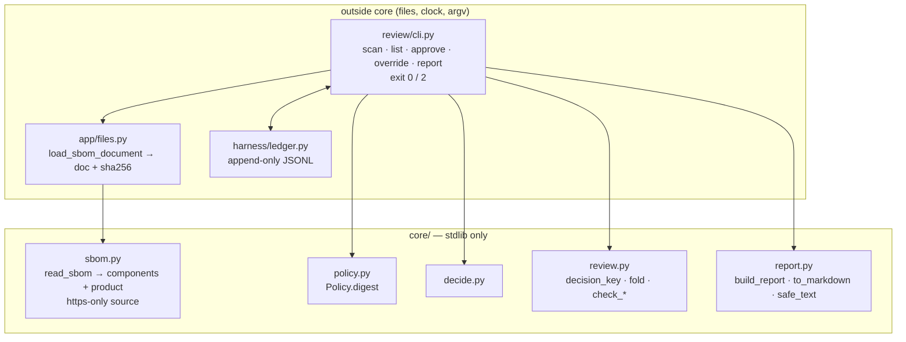

# Design — STORY-003: reviewer approve/override, audit ledger, exported report

Spec: `stories/STORY-003.md` (DR-1..DR-9), cases: `stories/STORY-003.cases.yaml` (S3-01..S3-12).
Level: **medium** — a new adapter (`review/`, the CLI), two new pure modules in `core/`, and two
small changes to STORY-001 code (`https`-only source links, the product exposed by the parser).

## Modules



```text
          outside core                                   core/  (stdlib only)
 ┌───────────────────────────────┐        ┌──────────────────────────────────────────────┐
 │ review/cli.py  (argparse)     │        │ sbom.py    read_sbom → components + product  │
 │  scan / list / approve /      │ ─────► │            https-only source link   (C5)     │
 │  override / report            │        │ policy.py  Policy.digest()                   │
 │  exit 0 ok · 2 refused        │        │ decide.py  decide()            (STORY-001)   │
 ├───────────────────────────────┤        │ review.py  decision_key()      (C12)         │
 │ app/files.py                  │        │            fold(ledger) → state per decision │
 │  load_sbom_document → sha256  │        │            check_approve / check_override    │
 ├───────────────────────────────┤        │ report.py  build_report → dict (raw)         │
 │ harness/ledger.py  (JSONL) ◄──┼── r/w  │            to_markdown(dict) escaped  (C4)   │
 └───────────────────────────────┘        └──────────────────────────────────────────────┘
```

The rule of the split: **anything Legal relies on is pure and in `core/`** (what counts as the same
decision, which line wins, what the report says, how text is escaped). The CLI only reads files,
reads the clock, appends lines and prints. Every rule can then be tested without a file or a clock.

## Ledger records

One ledger file per review (`--ledger`). Lines written by `harness.ledger.Ledger`, which adds `id`
and `at`. `fold` ignores kinds it does not know, so model-call lines from STORY-002 can share the file.

```
decision  { kind, key, identity, name, version, verdict, reason, source_url, policy_sha256 }
approve   { kind, decision, by, reason | null }
override  { kind, decision, verdict, by, reason }
```

## Key decisions

- **The reuse key is a digest of every input `decide()` reads (DR-4, C12).**
  `decision_key = sha256(canonical JSON of {identity, license_expression, source_url, policy_sha256})`.
  `scan` appends a decision only for keys it has not seen. A license change, a source change or a
  policy change gives a new key, so a new decision, so a new `pending` item (DR-5). Writing down
  *why* each field is in the key goes in DOCTRINE as D-08, because the next field someone adds to
  `decide()` has to be added here too, and only a test will notice (canary below).
- **The policy digest is over the loaded policy, not the file bytes.** `Policy.digest()` hashes the
  sorted, case-folded ids of each section. Editing a comment or reordering a list does not reopen
  every item; moving an id between sections does.
- **`https`-only goes in `core/sbom.py._first_url`, not in the renderer (DR-6, C5).** The source link
  is part of `Decision` and feeds `decide()`'s `no source declared` reason; fixing it at render time
  would leave a `javascript:` URL in the JSON Legal attaches. A non-`https` candidate is skipped and
  the next candidate is tried (a purl link can still win). This amends STORY-001 DR-7; the story gets
  a one-line note.
- **The product is returned, not inferred later (DR-8).** `read_sbom(doc) -> SbomDocument(components,
  product)`, with `product = Product(name, version) | None`. `parse_sbom` keeps its signature and
  returns `read_sbom(doc).components`, so STORY-001 code and tests do not change.
- **Final verdict = latest reviewer line on the decision (DR-3).** `fold` replays the ledger in file
  order; ties cannot happen because order is the file order, not the timestamp.
- **Refusals are checked against the ledger before writing (DR-1, DR-2).** `check_override` and
  `check_approve` raise `ReviewError` for a blank `by`/`reason`, an unknown verdict or a decision id
  that is not in the ledger. The CLI maps `ReviewError`, `FormatError` and `PolicyError` to exit 2 and
  writes nothing.
- **Escape once, in one place (DR-7, C4).** `safe_text` replaces every Unicode control or format
  character (categories `Cc`, `Cf`: ANSI escapes, newlines, bidi overrides) with `\uXXXX`.
  `md_cell` applies `safe_text` and backslash-escapes Markdown syntax (`\ | * _ [ ] < > # ``).
  Links are written as `<https://…>` autolinks after percent-encoding `<`, `>` and spaces. `list`
  prints through `safe_text`. The JSON is written from the same dict with `ensure_ascii=False`, raw.
- **Stable report (DR-9).** Components sorted by identity, then by key; reviews in ledger order;
  `json.dumps(..., sort_keys=True)`. The only field from the clock is `generated_at`.
- **Report before scan is refused.** A component with no recorded decision makes `report` exit 2
  (`run scan first`) instead of printing an incomplete file.
- **No interactive mode.** Tests call `review.cli.main(argv)` in-process; one smoke test runs
  `python -m review` as a subprocess to prove the entry point.

## File map

```
MODIFY core/sbom.py          _first_url: https only; Product, SbomDocument, read_sbom(); parse_sbom delegates
MODIFY core/policy.py        Policy.digest()
CREATE core/review.py        ReviewError, decision_key, fold -> {decision_id: ReviewState}, check_approve, check_override
CREATE core/report.py        build_report(...) -> dict, to_markdown(dict) -> str, safe_text, md_cell
MODIFY app/files.py          load_sbom_document(path) -> (SbomDocument, sha256 of the file bytes)
CREATE review/__init__.py, review/__main__.py, review/cli.py   argparse subcommands, exit codes
CREATE tests/story_003/__init__.py, tests/story_003/test_cases.py   one test per case id, from cases.yaml
CREATE tests/story_003/test_render.py   escaping and the https rule on their own
MODIFY stories/STORY-001.md  DR-7: a note that only https counts (STORY-003 DR-6)
MODIFY DOCTRINE.md           D-08: a frozen decision is keyed on every input it was decided from
MODIFY AGENTS.md             the review command in Commands
MODIFY scripts/canaries.py   one mutation per domain rule (below)
```

## Risks and how they are covered

| Risk | Cover |
|---|---|
| A field drops out of the key and two different components share a verdict (C12) | S3-08 + canary removing `license_expression` from the key |
| A policy edit is ignored on re-run | S3-09 + canary removing `policy_sha256` from the key |
| A non-`https` link reaches the JSON or the Markdown (C5) | S3-10 + canary accepting any scheme |
| SBOM text breaks the table or the terminal (C4) | S3-11 + canaries dropping the control-char and the `|` escapes |
| An override with no author or reason | S3-02 + canary removing the blank check |
| An override of a decision that does not exist | S3-06 + canary removing the existence check |
| The first reviewer line wins instead of the latest | S3-03 + canary reversing the fold |
| A re-run decides again | S3-05 + canary that always appends |
| The product leaves silently | S3-12 + canary returning `product=None` |
| STORY-001 behaviour changes with the parser refactor | the whole STORY-001 suite stays green, unchanged |

## Cross-file invariants

No separate artifact. DR-4 (the key covers every input of `decide()`) does cross two files that
are not linked by an import from the decider's side: `core/decide.py` reads the inputs and
`core/review.py` hashes them. That link is made explicit by DOCTRINE D-08 and enforced by the two key
canaries, which is the size of guard this repo needs.
