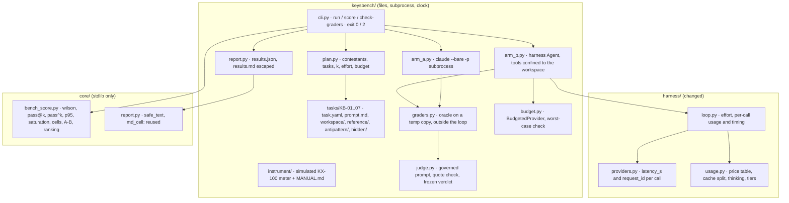
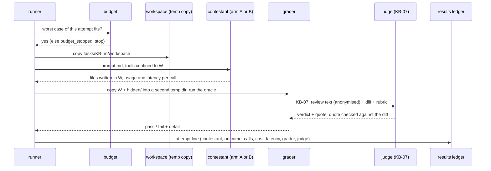

# Design — STORY-004: KeysBench

Spec: `stories/STORY-004.md` (DR-1..DR-13), cases: `stories/STORY-004.cases.yaml` (S4-01..S4-16).
Level: **medium-complex** — a new package (`keysbench/`), one new pure module in `core/`, and four
small changes to `harness/` that the benchmark needs and the agent of STORY-002 also benefits from.

## Verified before designing (2026-10-09)

| Question | Answer | How it was checked |
|---|---|---|
| SDK version in the repo | `anthropic` 1.12.1 | `uv pip show anthropic`; PyPI lists 1.12.1 as current (2026-10-08) |
| How effort is sent | `output_config={"effort": "low" \| "medium" \| "high" \| "xhigh" \| "max"}` on `messages.create` | the installed `types/output_config_param.py`; Context7 docs for the SDK |
| Which models accept effort | Fable 5.1, Opus 5.5, Sonnet 5.5, Haiku 5.5: all five levels | `models.retrieve(id).capabilities.effort` for each, and a live call with `effort: high` on Haiku 5.5 and Sonnet 5.5 (200, `end_turn`) |
| What `usage` looks like | `input_tokens`, `cache_creation_input_tokens`, `cache_read_input_tokens`, `cache_creation.{ephemeral_5m,ephemeral_1h}_input_tokens`, `output_tokens`, `output_tokens_details.thinking_tokens`, `inference_geo` | the same live calls |
| Claude Code headless | `claude --bare -p --model M --effort E --output-format json --max-budget-usd N` returns `usage` with the same split, `iterations` (one entry per model call), `modelUsage[M].costUSD` with `costBasis: "unknown"`, `ttft_ms`, `duration_ms`, `num_turns`, `stop_reason`, `is_error` | one run (Claude Code 2.1.285, Haiku 5.5, a one-file task in a temp dir) |
| Prices | per million tokens: Fable 5.1 10 / 12.50 / 20 / 0.25 / 50 · Opus 5.5 4 / 5 / 8 / 0.20 / 20 · Sonnet 5.5 2 / 2.50 / 4 / 0.10 / 10 · Haiku 5.5 (prompt ≤ 100k) 0.10 / 0.125 / 0.20 / 0.01 / 0.50 (input / 5-min write / 1-h write / read / output) | the provider's pricing page, 2026-10-09 |

Two consequences for the spec, both recorded there:

- **Arm A cost can be measured too.** The CLI reports the same `usage` split per call (`iterations`),
  so arm-A cost is computed from it with the same table, labelled `cli-usage`; the CLI's own
  `costUSD` is stored beside it as a cross-check, not used.
- **Claude Code takes `--effort`**, so arm A runs at the same fixed effort as arm B.

## Modules



```text
 keysbench/  (files, subprocess, clock)                         harness/  (changed)
 ┌─────────────────────────────────────────────────┐            ┌─────────────────────────────────────┐
 │ cli.py      run · score · check-graders  0 / 2  │            │ loop.py      effort sent + recorded │
 │ plan.py     contestants × tasks × k, budget     │  arm B ──► │              per-call usage, timing │
 │ arm_b.py    Agent + list/read/write in workspace│ ─────────► │ providers.py latency_s, request_id  │
 │ budget.py   BudgetedProvider (worst case first) │            │ usage.py     price table, cache 5m/ │
 │ arm_a.py    claude --bare -p --model --effort   │            │              1h/read, thinking, tier│
 │ graders.py  oracle on a temp copy, after the run│            └─────────────────────────────────────┘
 │ judge.py    KB-07 only: quote checked, frozen   │            core/  (stdlib only)
 │ report.py   results.json raw → results.md       │ ─────────► ┌─────────────────────────────────────┐
 │ tasks/      KB-01..KB-07 + instrument/ (KX-100) │            │ bench_score.py  wilson · pass@k ·   │
 │ cassettes/  arm-B + judge calls, arm-A outputs  │            │   pass^k · p95 · saturation · cells │
 │ results/    2026-10/ the recorded live run      │            │   · A−B · ranking statement         │
 └─────────────────────────────────────────────────┘            │ report.py  safe_text, md_cell       │
                                                                └─────────────────────────────────────┘
```

The rule of the split is the one STORY-003 used: **everything the conclusion rests on is pure and in
`core/`** (how a pass rate becomes an interval, what saturated means, when a ranking is allowed).
`keysbench/` runs things and moves files.

## One attempt, end to end



```text
 runner ──worst case fits?──► budget ──no──► budget_stopped (rest of the plan), stop
   │ yes
   ├──► copy tasks/KB-nn/workspace ──► temp dir W
   ├──► contestant (arm B: harness, list/read/write in W · arm A: claude in W) ──► files in W
   │                                        usage + latency + request id per call
   ├──► grader: copy W + hidden/ to a second temp dir, run the oracle (outside the loop)
   │       └── KB-07: judge(review anonymised, diff, rubric) ──► quote in diff? else fail
   └──► results ledger: one attempt line
```

## Key decisions

- **Per-call facts are captured by the provider, not reconstructed (DR-4).** `AnthropicProvider`
  times the call and reads the `request-id` header (`with_raw_response`), and adds them to the
  returned dict as `"_call": {"latency_s", "request_id"}`. `RecordingProvider` stores the dict as it
  is, so the cassette carries the measured latency and `ReplayProvider` returns it: a replayed run
  reports what was measured, not its own near-zero time. The loop copies `_call` into each
  `model_call` ledger line. The response has no credential in it; a test asserts the cassette has no
  `api_key`, `x-api-key` or `sk-ant` string.
- **Effort goes in the request (DR-2).** `Agent(effort=...)` sends `output_config={"effort": effort}`
  on every call and writes it in `run_start`. Because it is part of the request, it is part of the
  cassette key: a recording made at `high` cannot answer a run at `medium`.
- **Cost per call, then summed; one unpriced call makes the total unpriced (DR-3).** `usage.py` gets
  `PRICES: dict[str, Price]` with `Price(input, cache_write_5m, cache_write_1h, cache_read, output,
  max_prompt_tokens)`, `PRICES_CHECKED_ON = "2026-10-09"`. `call_cost(raw_usage, model)` returns
  `None` for an unknown model, for a call whose prompt (all three input counters) is above
  `max_prompt_tokens` (Haiku 5.5's 100k tier is not in the table on purpose), and for cache writes that
  come without the 5m/1h split. `Usage` also accumulates `thinking_tokens`. The loop keeps the list of
  per-call costs; the run's `cost_usd` is their sum, or `None` if any is `None`.
- **A refusal is a stop reason, mapped by the runner (DR-5).** The loop already ends on any non
  `tool_use` stop and returns `stop_reason`; the runner maps `refusal` to the `refused` outcome. No
  loop change; a test pins it.
- **Arm B tools: list, read, write, nothing that runs code (DR-6).** Three `harness` tools whose
  `path_args` are confined by the existing `Gate` to the attempt's workspace. A write outside it is
  denied by the gate, as for the STORY-002 agent. `max_steps = 12`, `max_tokens = 4000`.
- **Arm A: Claude Code on a temp copy, with a small tool allowlist (DR-6).** `claude --bare -p
  <prompt> --model M --effort E --output-format json --max-budget-usd <remaining>
  --permission-mode dontAsk --allowedTools Read Edit Write Glob Grep "Bash(python *)"` with `cwd` = the
  workspace and an environment that holds only `PATH`, `SYSTEMROOT`/`HOME` and the API key. It can run
  Python in the workspace (that is part of the product harness), and nothing else. No network
  isolation: written in Limits.
- **Arm A in CI: replay the outcome, not the conversation.** CI cannot replay a CLI. Each live arm-A
  attempt stores its JSON output and the files it changed in the workspace
  (`cassettes/arm_a/<task>-<model>-<effort>-<n>.json`, keyed on the task digest). Offline, the runner
  writes those files into a fresh workspace and grades them: the grader and the report are exercised
  in CI; the model is not called.
- **Budget is a provider wrapper, checked before each call (DR-11).** `BudgetedProvider(inner, budget)`
  computes the worst case of the next call before making it: an upper bound of its prompt (UTF-8 bytes
  of the request ÷ 2, a deliberately high tokens estimate) at the input price, plus `max_tokens` at the
  output price. If `spent + worst_case > cap`, it raises `BudgetStopped`, and the runner records that
  attempt and every remaining cell as `budget_stopped`. After the call it adds the real cost. Arm A
  passes `cap − spent` to `--max-budget-usd` and adds the measured cost after. Unpriced calls cannot be
  budgeted, so the runner refuses to start a live run for a model without a price.
- **Graders run after the attempt, on a second copy (DR-6, DR-7).** The contestant never sees
  `hidden/`. `graders.py` copies the attempt's workspace plus `hidden/` into another temp dir and runs
  the oracle: `python -m pytest -q -B -p no:cacheprovider` with `PYTHONDONTWRITEBYTECODE=1` (the same
  stale-`.pyc` lesson as the canaries) and a wall-clock limit. KB-04 and KB-06 compare numbers with a
  stated tolerance; KB-05 reads `answer.json` and checks `feasible: false` and that `quote` is a
  substring of `MANUAL.md`; KB-07 calls the judge.
- **Each grader is validated by the three solutions every task ships (DR-7).** `check-graders` runs
  each grader on `workspace/` (base), `reference/` and `antipattern/`, expecting 0, 1, 0. It runs in CI
  (offline: the KB-07 judge calls for the three are recorded). Canaries break graders, not tests: one
  per grader family (a pytest grader that ignores the exit code, a numeric grader with the tolerance
  widened, a quote check that always passes, a saturation rule that never fires).
- **The judge (DR-8).** One governed prompt (`keysbench/judge/prompt.md`, approved by hash in the
  existing `PromptRegistry`). Input: the rubric, the diff, and the contestant's review with every model
  id and model family name replaced by `<contestant>`. Output: structured `{verdict: pass | fail,
  defect_found: bool, quote}`. The code checks `quote` is in the diff (whitespace-normalised, never
  quote characters), else `fail / quote not found`. Judge model: Opus 5.5, or Sonnet 5.5 when the
  contestant is Opus 5.5. The verdict is frozen in the results ledger under
  `judge_key = sha256({task_sha256, artifact_sha256, rubric_sha256, judge_prompt_sha256, judge_model})`;
  `score` reads a frozen verdict and calls the judge only for a key it has not seen.
- **The scorer is pure (DR-9, DR-10, DR-13).** `core/bench_score.py`: `wilson(passes, n)`,
  `pass_at_k(n, c, k)` (unbiased estimator), `pass_hat_k(n, c, k)`, `percentile(values, 0.95)` by
  nearest rank, `cells(rows)` grouped by `(task_id, task_sha256, arm, model, effort)` so two task
  digests never merge, `saturated(cells, arm)`, `harness_delta(cells)` (A pass rate − B pass rate per
  model over the tasks both arms ran), and `ranking_statement(n_tasks)` returning `"none: n <= 8 tasks"`
  for n ≤ 8. `report.py` orders contestants by name, never by score, when the statement is `none`.
- **The report reuses STORY-003's escaping (DR-16 in the cases).** `results.md` is derived from
  `results.json` through `core.report.safe_text` and `md_cell`; contestant text (an answer, a review
  excerpt, a grader detail) is data.

## The fictitious instrument (KX-100) and the tasks

`keysbench/instrument/` holds a stdlib simulator of an RF power meter and its manual. The simulator is
an in-process session with `write`, `read`, `query`, a termination character and a timeout, so a
driver talks to it the way it would talk to a VISA session. It implements `*IDN?`, `*RST`, `*OPC?`,
`SYST:ERR?`, `SENS:FREQ`, `SENS:AVER:COUN`, `CONF:POW:RANG`, `INIT`, `FETC?` and `TRAC:DATA?` (an IEEE
488.2 definite-length block). Readings are deterministic for a given seed, and a measurement with
averaging count N takes N × 25 ms of simulated time, which is what makes the KB-03 timeout bug real.
`MANUAL.md` (about 150 lines) carries the command reference, the specification table used by KB-04 and
the limits used by KB-05 (resolution 0.01 dB, 10 MHz to 18 GHz).

| Task | `workspace/` (what the contestant gets) | `hidden/` (oracle) | antipattern |
|---|---|---|---|
| KB-01 | `core/` copy with one seeded regression + `BUG.md` in prose | the repo's tests for that module | fixes the symptom in the test, not the code |
| KB-02 | `driver.py` stub, `MANUAL.md`, simulator | tests: frequency set before the read, averaging applied, `SYST:ERR?` checked | reads before `INIT` (returns the previous value) |
| KB-03 | a driver with a fixed 1 s timeout and a wrong terminator for block reads | a test at averaging 64 that hangs on the buggy driver | raises the timeout to 60 s for every command |
| KB-04 | `uncertainty.py` stub, the manual's spec table | reference value at three readings, tolerance 0.5 % | adds contributions linearly instead of root-sum-square |
| KB-05 | a request for 0.001 dB at 40 GHz | `answer.json` says not feasible and quotes a manual line | returns a value anyway |
| KB-06 | `trace.py` stub, a recorded block | RMS within 1e-9; truncated and wrong-length blocks raise `ValueError` | ignores the length header |
| KB-07 | `change.diff` (dBm→W conversion with `/20` instead of `/10`), `REVIEW.md` to write | judge + rubric, quote checked against the diff | a review that praises the change and nits style |

Prompts are frozen in `prompt.md` and describe the work the way a ticket would, without naming the
oracle. Every task directory has a digest (`task_sha256`, over every file, sorted) that goes on each
row.

## Plan file

`keysbench/plans/2026-10.yaml`: benchmark label, budget (60 USD), k (3), effort (`high`), the four
model ids as returned by `/v1/models`, arms (A, B), judge models, and the `not_run` list (Codex CLI,
Cursor agent, with the reason). The runner refuses a plan whose model ids are not in the price table.

## File map

```
CREATE: keysbench/__init__.py, keysbench/__main__.py, keysbench/cli.py, keysbench/plan.py
CREATE: keysbench/arm_a.py, keysbench/arm_b.py, keysbench/budget.py, keysbench/graders.py
CREATE: keysbench/judge.py, keysbench/judge/prompt.md, keysbench/judge/rubric-kb07.yaml
CREATE: keysbench/report.py, keysbench/plans/2026-10.yaml
CREATE: keysbench/instrument/sim.py, keysbench/instrument/MANUAL.md
CREATE: keysbench/tasks/KB-01..KB-07/{task.yaml, prompt.md, workspace/, reference/, antipattern/, hidden/}
CREATE: keysbench/cassettes/ (arm B + judge recordings, arm A outcomes)
CREATE: keysbench/results/2026-10/{ledger.jsonl, results.json, results.md}   (from the live run)
CREATE: core/bench_score.py
CREATE: tests/story_004/{__init__.py, test_score.py, test_usage_prices.py, test_runner.py, test_graders.py, test_judge.py, test_report.py}
MODIFY: harness/usage.py      (Price table, call_cost, cache split, thinking, tier)
MODIFY: harness/providers.py  (latency_s, request_id per call)
MODIFY: harness/loop.py       (effort, per-call cost list, _call into model_call lines)
MODIFY: prompts/approved.json (judge prompt approval)
MODIFY: scripts/canaries.py   (grader, scorer, budget, usage canaries)
MODIFY: scripts/ci.sh         (check-graders; the leak gate as a failing check)
MODIFY: pyproject.toml        (mypy files += keysbench)
MODIFY: AGENTS.md, DOCTRINE.md (D-09, D-10), README.md, STATED.json
```

## Doctrine to add

- **D-09 — A result belongs to (harness, model, effort).** Every row names all three plus the harness
  version; arm A and arm B never share a ranked table. **Why:** the same model moves by more than the
  gap between neighbouring models when the harness changes. **Cost:** twice the runs for one question.
- **D-10 — A grader is trusted once it has been seen failing.** Base 0, reference 1, antipattern 0, in
  CI, and a canary per grader family. **Why:** a grader that cannot fail turns every contestant green.
  **Cost:** three solutions per task, written before the task is used.

## Risks

- **Saturation.** Tasks the four models all pass carry no information. The saturation rule makes that
  visible instead of hiding it in an average; the pilot (one task, one model, both arms) shows whether
  the set is too easy before the grid spends the budget.
- **Arm A runs code on this machine.** Limited to `python` in a temp copy, with a stripped environment;
  no network isolation. Acceptable for a POC driven by its author, not for a shared runner.
- **Cost.** Fable 5.1 dominates. The cap stops the run; the order of the grid is Haiku, Sonnet, Opus,
  Fable, so a stop leaves the cheapest complete rather than the most expensive half-done.
- **Judge bias.** Same family as the contestants; mitigated (anonymised, different model, quote checked),
  not removed. Stated in the report.
- **Leak gate.** The task files are new text; the CI check `git grep -i -E` over tracked files (not
  only the tree at hand) must stay at zero.

## Concept candidates

None marked in the spec. The cross-file invariant that matters (a frozen verdict is keyed on every
input) already lives in DOCTRINE D-08, and `judge_key` follows it.
