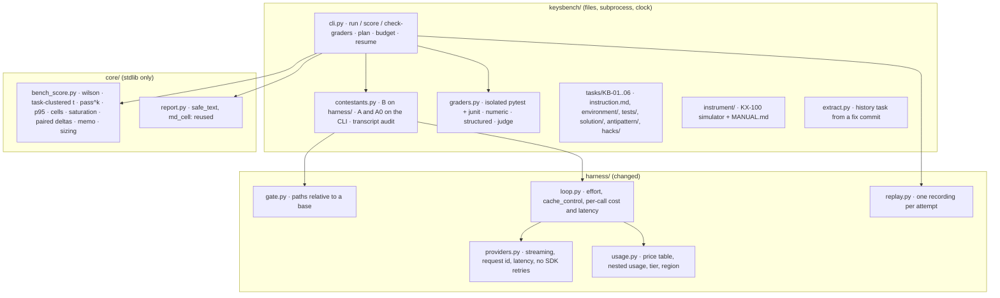

# Design — STORY-004: KeysBench

Spec: `stories/STORY-004.md` (DR-1..DR-15), cases: `stories/STORY-004.cases.yaml` (S4-01..S4-19).
Level: **medium-complex** — a new package (`keysbench/`), one new pure module in `core/`, and five
changes to `harness/` that the benchmark needs and the STORY-002 agent also benefits from.

Revised after an adversarial review of the first version (six lenses, every finding re-checked by
a verifier that tried to refute it): `docs/design/STORY-004-challenge.md` lists each finding, its
verdict and what it changed here.

## Verified before designing (2026-10-09)

| Question | Answer | How it was checked |
|---|---|---|
| SDK version in the repo | `anthropic` 1.12.1 | `uv pip show anthropic`; PyPI lists 1.12.1 as current |
| How effort is sent | `output_config={"effort": "low" \| "medium" \| "high" \| "xhigh" \| "max"}` | the installed `types/output_config_param.py`; the SDK docs |
| Which models accept effort | Fable 5.1, Opus 5.5, Sonnet 5.5, Haiku 5.5: all five levels | `models.retrieve(id).capabilities.effort`; live calls at `high` on Haiku 5.5 and Sonnet 5.5 |
| `usage` shape | flat `input_tokens`, `cache_creation_input_tokens`, `cache_read_input_tokens`, `output_tokens`; **nested** `cache_creation.{ephemeral_5m,ephemeral_1h}_input_tokens` and `output_tokens_details.thinking_tokens`; `inference_geo` | the same live calls |
| Thinking and `max_tokens` | thinking counts toward `max_tokens`; the provider's guidance at `high` is a large `max_tokens` with streaming | the provider's effort documentation |
| Non-streaming limit | the SDK refuses a non-streaming call when `3600 × max_tokens / 128000 > 600` (above 21,333 tokens) | `anthropic/_base_client.py`, and a mock-transport test (21,333 ok, 21,334 refused) |
| Request id | `message._request_id` is set on the parsed message and dropped by `model_dump` | `anthropic/_models.py`; a mock-transport test |
| Top-level `cache_control` | accepted by `messages.create`; marks the last cacheable block | `types/message_create_params.py` |
| Claude Code headless | `--bare -p --model --effort --output-format json --max-budget-usd` returns `usage` (same split), `iterations` per call, its own cost estimate, `ttft_ms`; `--restricted` ignores user/project/local settings, confines file tools to the working directories and drops command tools unless `--tools` names them; `--settings`, `--tools`, `--no-session-persistence` exist (2.1.285) | one run on a one-file task; `claude --help`; the CLI and permissions documentation |
| `--bare` alone | does **not** skip settings files: the user `env` block and `permissions.allow` would still apply | the CLI help and permissions documentation (inferred, confirmed in the pilot) |
| Arm A on Windows, CLI 2.1.285 (2026-10-11) | `claude-haiku-5-5` is `unrecognized_model`: the CLI priced a run at 0.0354 USD whose usage costs 0.0009 USD, so its `--max-budget-usd` would stop runs early; the API key in the CLI's environment **is visible to the contestant's Python**; user-settings `env` names do not leak | one restricted, bare run on a one-file task with a decoy variable and an env dump from Python |
| Arm A on Windows, CLI 2.1.296 (2026-10-11) | the model is recognised and the CLI's cost equals ours (0.00091 USD, `costBasis: list`); `CLAUDE_CODE_SUBPROCESS_ENV_SCRUB=1` removes the key from subprocesses (and forces permission mode `default`); `Read` and `cat` outside the workspace are denied; read-only commands such as `whoami` are **auto-allowed** despite a `Bash(python *)`-only allow list, but confined to the working directory; without stdin the CLI waits 3 s | the same run with the pinned CLI in its own prefix, the scrub on, and a `cat` outside the workspace |
| Prices | per million tokens, input / 5-min write / 1-h write / read / output: Fable 5.1 10 / 12.50 / 20 / 0.25 / 50 · Opus 5.5 4 / 5 / 8 / 0.20 / 20 · Sonnet 5.5 2 / 2.50 / 4 / 0.10 / 10 · Haiku 5.5 (prompt ≤ 100k) 0.10 / 0.125 / 0.20 / 0.01 / 0.50; region `global` | the provider's pricing page |

## Modules



```text
 keysbench/  (files, subprocess, clock)                       harness/  (changed)
 ┌──────────────────────────────────────────────────┐         ┌──────────────────────────────────────┐
 │ cli.py         run · score · check-graders       │         │ gate.py      paths relative to base  │
 │                plan, budget, resume, rounds      │  B ───► │ loop.py      effort, cache_control,  │
 │ contestants.py B on harness/                     │ ──────► │              per-call cost + latency │
 │                A, A0 on claude --restricted      │         │ providers.py stream, request id,     │
 │                transcript audit → invalid        │         │              latency, max_retries=0  │
 │ graders.py     declared files only, python -I,   │         │ usage.py     table, nested, tier,    │
 │                junit, subprocess call, judge     │         │              region → null if unknown│
 │ extract.py     fix commit → history task         │         │ replay.py    one file per attempt    │
 │ tasks/ KB-01..06   instrument/ KX-100            │         └──────────────────────────────────────┘
 └──────────────────────────────────────────────────┘         core/  (stdlib only)
                          │                                   ┌──────────────────────────────────────┐
                          └─────────────────────────────────► │ bench_score.py  wilson · t by task · │
                                                              │   pass^k · p95 · cells · saturation ·│
                                                              │   paired deltas · memo · sizing      │
                                                              │ report.py       safe_text, md_cell   │
                                                              └──────────────────────────────────────┘
```

The rule of the split is STORY-003's: **everything the conclusion rests on is pure and in `core/`**
(how pass rates become intervals, what saturated means, how a delta is paired, what the memo says,
how many tasks a decision needs). `keysbench/` runs things and moves files. Four modules, not eight:
plan loading and the budget live in `cli.py`; the three configurations share `contestants.py`.

## One attempt, end to end

```mermaid
sequenceDiagram
  participant R as runner
  participant W as workspace (temp copy)
  participant C as contestant (B, A or A0)
  participant G as grader (second temp copy)
  participant J as judge (KB-06)
  participant L as ledger
  R->>L: already recorded? skip
  R->>W: copy environment/ (no history, no solutions)
  R->>C: instruction.md, relative paths only
  C-->>R: files in W · per call: usage, latency, request id, retries
  R->>R: A and A0: audit transcript, outside W → invalid
  R->>G: declared editable files + tests/ into a fresh dir
  G->>G: python -I -B -m pytest --noconftest, junit outside, contestant code in a subprocess
  G->>J: KB-06: review as data + diff + rubric (anonymised)
  J-->>G: verdict + review_quote; code checks it is in the review and points at the planted line
  G-->>R: pass / fail / failed checks
  R->>L: attempt line (judge verdict frozen here)
```

```text
 runner ──recorded already?──yes──► skip (resume)
   │ no
   ├─► copy environment/ to W (no .git, no solution/, no tests/)
   ├─► contestant B / A / A0 in W ──► files · usage, latency, request id, retries per call
   ├─► A, A0: audit every tool input in the transcript ──outside W──► invalid
   ├─► grader: declared files + tests/ ─► fresh dir ─► python -I -B -m pytest --noconftest
   │        junit outside the dir · contestant code called in a subprocess · type-strict compare
   │        └── KB-06: judge(review as data, diff, rubric) ─► review_quote in review? at planted line?
   └─► ledger: one attempt line, judge verdict frozen on it
```

## Key decisions

### Harness

- **Paths are relative to the workspace (DR-12).** `Gate(read_roots, write_roots, base=W)` resolves
  `(base / raw).resolve()`; the arm-B tools take workspace-relative paths, refuse absolute paths and
  `..`, and resolve through the same function as the gate, so the gate and the tool check one path.
  `list` returns sorted `/`-separated paths. The prompt never names the temporary directory, so a
  recording made on Windows replays on Linux. (Today `Gate` resolves against the process working
  directory: a relative path is denied, which a verifier reproduced with the real class.)
- **One recording per attempt (DR-12).** Three attempts of a cell send the same first request, and
  `ReplayProvider` keeps the last recording of a key: three attempts replayed as three copies of the
  last (reproduced). Recordings are stored as `cassettes/<task_sha256[:12]>/<config>-<model>-<effort>-<n>.jsonl`;
  the runner opens the recording of the attempt it is replaying. `ReplayProvider` itself does not change.
- **Streaming, `max_tokens = 32000`, no SDK retries (DR-4, DR-5).** At `high`, thinking counts toward
  `max_tokens`; 4,000 would end attempts on the cap rather than on ability, and the SDK refuses
  non-streaming calls above 21,333. `AnthropicProvider` streams (`messages.stream(...)` → final message),
  records time to first token and total time, reads `_request_id` before `model_dump`, and is built with
  `max_retries=0`; the runner retries (twice, with backoff) and each try is its own `model_call` line.
  The returned dict carries `"_call": {latency_s, ttft_s, request_id}`; it is response data, not
  request data, so cassette keys do not change. A `max_tokens` stop is `truncated`.
- **Effort and caching are part of the request (DR-2).** `Agent(effort=..., cache=True)` sends
  `output_config={"effort": effort}` and top-level `cache_control={"type": "ephemeral"}` on every call
  (the history grows each step; without caching each step pays for it again, and A and A0 already
  cache). Both enter the cassette key, so a recording at one setting cannot answer a run at another.
- **Cost per call, summed; one unpriced call makes the total unpriced (DR-3).** `usage.py`:
  `PRICES: dict[str, Price(input, cache_write_5m, cache_write_1h, cache_read, output, max_prompt_tokens)]`,
  `PRICES_CHECKED_ON = "2026-10-09"`, `PRICED_REGION = "global"`. `call_cost(raw_usage, model)` returns
  `None` for an unknown model, a prompt above `max_prompt_tokens` (Haiku 5.5's 100k tier is left out on
  purpose), a cache write without its 5m/1h split, or a region other than `global`. `Usage.add` reads
  the nested keys explicitly. The loop keeps per-call costs; the run's cost is their sum, or `None`.
- **Latency of an attempt = sum of recorded call latencies (DR-4).** `run_end` gets `latency_s`
  (that sum) and `wall_s` (the clock around the loop, tools included). Replay reports the first.

### Contestants

- **B (baseline)**: the harness `Agent` with three tools (`list`, `read`, `write`), `max_steps = 12`.
- **A and A0**: `claude --restricted --bare -p <instruction> --model M --effort high --output-format
  stream-json --verbose --max-budget-usd <remaining> --settings <file> --strict-mcp-config
  --no-session-persistence --permission-mode dontAsk`, with `--tools "Read,Edit,Write,Glob,Grep,Bash"`
  for A and `--tools "Read,Edit,Write,Glob,Grep"` for A0. The settings file allows `Bash(python *)` only,
  sets `blockReadsOutsideWorkingDirectories`, and has an empty `env`; the process environment holds only
  what the CLI needs to start (measured in the pilot) and the API key. `--restricted` is the reason user
  settings (an `env` block naming credential files, a broad `allow`) do not reach the session; `--bare`
  alone would not stop them.
- **Measured on Windows (T0), and what it changes:**
  - **The CLI is pinned and installed in its own prefix.** The version is recorded on every row.
    Version 2.1.285 did not know the 5.5 models and mispriced them; 2.1.296 does.
  - **`CLAUDE_CODE_SUBPROCESS_ENV_SCRUB=1` is set on every run**, so the API key never reaches the
    contestant's processes. Its side effect, permission mode `default`, is what a non-interactive run
    needs anyway: an unapproved action is denied, never asked.
  - **Arm A is "Python plus the CLI's read-only commands, confined to the workspace", not "Python
    only".** The CLI auto-allows read-only commands, but refuses their paths outside the working
    directory. The audit still marks any absolute path outside W as `invalid`.
  - **`stdin` is closed** (`DEVNULL`).
- **After the code review (2026-10-11), each reproduced:**
  - **The CLI is called as its executable** (`bin/claude.exe` on Windows), never through the `.cmd` shim:
    cmd.exe ends a command line at the first newline, so a multi-line prompt dropped every flag after it
    (model, budget, tools, settings). `command()` refuses a `.cmd`/`.bat` with a multi-line prompt.
  - **A timeout kills the whole process tree.** Killing only the CLI left its children holding the output
    pipe, and a 2 s limit took 12 s.
  - **Stored transcripts are workspace-independent.** The CLI writes absolute paths; storing replaces the
    live workspace with `<W>` (with `/` separators) and restoring maps it to the replay workspace, so an
    attempt audits the same way on replay, on any OS.
  - **`permissions.blockReadsOutsideWorkingDirectories: true`** in both settings files (the key path is the
    CLI's own). With it the CLI also refuses commands whose paths are computed at run time.
  - **No `--permission-mode dontAsk`**: `CLAUDE_CODE_SUBPROCESS_ENV_SCRUB=1` forces mode `default`, where a
    non-interactive run denies anything it would have asked about.
- **Audit, then grade (DR-14).** The stream-json transcript is kept. Every tool input is checked: a
  file path that resolves outside W, or any absolute path in a command, makes the attempt `invalid`.
  This is detection: Python can build a path at runtime, and the report says so.
- **Arm A offline.** CI cannot replay a CLI. A live A/A0 attempt stores its transcript and the files it
  changed; offline, the runner writes those files (each path through the same relative-path resolver)
  into a fresh workspace and grades them, so the grader, the audit and the report are exercised in CI.

### Graders (DR-6, DR-7)

- **Only declared files cross over.** `task.toml` lists `editable` files. The grader builds a fresh
  directory from those files plus `tests/`, nothing else the contestant created.
- **Isolated run.** `python -I -B -m pytest --noconftest -p no:cacheprovider -c <grader ini outside the
  dir> --rootdir <dir> --junitxml=<outside>`, `PYTEST_DISABLE_PLUGIN_AUTOLOAD=1`, an explicit
  environment with no `ANTHROPIC_*`/`CREDENTIALS_*`, a wall-clock limit. (`-B` belongs to Python, not
  pytest; `-I` is what stops a `pytest.py` in the directory from shadowing pytest; `--noconftest` is
  what stops a planted `conftest.py`.)
- **Pass = the report lists every expected test id as passed.** A missing report (an `os._exit(0)` at
  import) is a fail; a skip, an xfail or an error is a fail.
- **The contestant's code runs out of the test process.** Hidden tests call it through
  `python -I -c "import <module>; print(json.dumps(<call>))"` in the grading dir and compare the parsed
  value with type checks. An object equal to everything, or a patched test runner, cannot reach the
  assertion. (Measured: with the code imported in-process, both still passed under the junit rule.)
- **Structured answers (KB-05).** `answer.json` must say `feasible: false`, and `quote` must contain one
  of the task's declared limit lines (whitespace-normalised). A one-character quote was a pass under
  "substring of the manual"; it is not now.
- **The judge (KB-06).** One governed prompt (approved by hash). Input: the rubric, the diff, and the
  review between data delimiters with model ids replaced by `<contestant>`. Output:
  `{verdict, defect_found, review_quote}`. Code: `review_quote` is in `REVIEW.md` (whitespace-normalised)
  **and** contains the planted line or its declared marker (`/ 20`); otherwise `fail` with the reason.
  The judge model is Opus 5.5, or Sonnet 5.5 when the contestant is Opus 5.5. It runs during the
  attempt and its verdict is written on the attempt line with the prompt, rubric and artifact digests;
  `score` never calls it.
- **Seen failing.** `check-graders` runs every task's `environment/` (base), `solution/`, `antipattern/`
  and each `hacks/<name>/` through its grader and expects 1 for the solution and 0 for the rest. Canaries
  break graders: the junit rule (accept exit code), `--noconftest` removed, `-I` removed, the KB-05 limit
  check (accept any substring), the KB-06 quote check (accept a quote from the diff), saturation that
  removes tasks, the clustered interval replaced by pooled Wilson.

### Scorer (core/bench_score.py, pure)

- `wilson(passes, n)` per cell; `pass_hat_k(n, c, k)`; `any_pass`; `percentile(values, 0.95)` by nearest
  rank; `cells(rows)` grouped by `(task_id, task_sha256, config, model, effort)`.
- `task_clustered(rates)`: mean of per-task pass rates and a t interval with `df = n_tasks − 1`, clipped
  to [0, 1] (t critical values for df 1..30 in a table: stdlib has no t distribution). The task is the
  independent unit; Wilson over pooled attempts was about half as wide as it should be.
- `saturated(cells, config)` flags; it never filters. `paired_delta(rates_x, rates_y)`: per-task
  differences over the tasks both configurations ran, mean and clustered t interval. Deltas: A0 − B and
  A − A0 per model.
- `memo(cells, rows)`: per-task results with cost per pass and p95; commodity = saturated tasks with the
  cheapest passing contestant and its cost per pass; failure modes = failed check ids mapped to the names
  each task declares, counted per contestant; decision grade = the measured discordance rate between
  contestants and the paired sample size for a 15-point difference at α 0.05 two-sided and 80 % power
  (`n = (z_{α/2} √d + z_β √(d − δ²))² / δ²`), times this run's measured cost per task.
- `ranking_statement(n_tasks)`: `"none: n <= 8 tasks"` for n ≤ 8; contestants are then ordered by name.

### Runner (cli.py)

- **Plan.** `keysbench/plans/2026-10.yaml`: label, cap (60 USD), k (3), effort (`high`), the four model
  ids as returned by `/v1/models`, configurations (B, A0, A), judge models, `not_run` with reasons.
  A model with no price is refused before anything runs.
- **Rounds and resume (DR-15).** Attempts run round by round (attempt 1 of every cell, cheapest models
  first within a round, then attempt 2…). Before each attempt the runner checks the ledger and skips
  what is already recorded.
- **Budget (DR-11).** Projection before a live run: measured mean cost per attempt per (config, model)
  from the ledger (a pilot run first) × the attempts left; above the cap → exit 2. Per call: reserve
  `prompt bound × input price + max_tokens × output price`, where the prompt bound is the previous
  call's measured input plus one token per byte of what was added since; settle with the measured cost.
  A call that would cross the cap is not made; the attempt is `budget_stopped` with its spend counted.
  A and A0 get `--max-budget-usd = cap − spent`.
- **The first live run has nothing to project from.** For a (config, model) with no measured attempt in
  the ledger, the projection is skipped and only the per-call reservation applies. That is the rule the
  pilot runs under; the grid runs after it, with a projection.
- **Recordings `check-graders` needs.** The KB-06 solution, antipattern and fake-verdict hack each need a
  judge call. `check-graders --live` records those three once (Sonnet 5.5 or Opus 5.5, a few cents);
  every later `check-graders`, CI included, replays them.
- **Task trees are data, not repo code.** `keysbench/tasks/` holds planted `conftest.py` and `pytest.py`
  files and two old copies of `core/`. Pytest only collects `tests/` (`testpaths`), and `ruff` and `mypy`
  exclude `keysbench/tasks/`; a test asserts the repo suite never collects anything under it.
- **Every A/A0 row records the CLI version.** The installed CLI is 2.1.285; the headless documentation
  says bare-mode limits held only partly before 2.1.286. The pilot runs on the newest CLI and checks that
  no user `env` name reaches a `Bash` subprocess.
- **Traceability (DR-13).** `results.json.inputs` records the sha256 of the ledger and of every
  recording it was scored from.

## Tasks

Task folders follow the layout of the Terminal-Bench / Harbor format (`instruction.md`,
`environment/`, `tests/`, `solution/`) plus `antipattern/` and `hacks/`, so a container runner can take
them later. `task.toml` holds the id, family, editable files, expected test ids, tolerance, declared
limit lines (KB-05), the planted line and its marker (KB-06), and failure-mode names per check.

| Task | Source | `environment/` | Oracle | antipattern |
|---|---|---|---|---|
| KB-01 | fix commit `341fb07` (deep nesting → `RecursionError`) | the parent tree of `core/` and its tests, no history, the report in prose | the test the fix added (fails on the parent) plus the module's tests | catches `RecursionError` and returns `Needs review` for everything |
| KB-02 | fix commit `9e92220` (nested SBOM components) | as above | the 2 tests the fix added plus the module's tests | flattens only one level |
| KB-03 | KX-100 | `driver.py` stub, `MANUAL.md`, the simulator | hidden tests through the simulator: frequency set before the read, averaging applied, `SYST:ERR?` checked | reads before `INIT` (returns the previous value) |
| KB-04 | KX-100 | `uncertainty.py` stub, the specification table | reference at three readings, tolerance 0.5 % | adds contributions linearly instead of root-sum-square |
| KB-05 | KX-100 | a request for 0.001 dB at 40 GHz | `answer.json`: not feasible, quote contains a declared limit line | returns a value anyway |
| KB-06 | KX-100 | `change.diff` with dBm→W using `/ 20`, `REVIEW.md` to write | judge + rubric, quote in the review at the planted line | a review that praises the change and nits style |

`extract.py` builds KB-01 and KB-02 from their commits: export the parent tree without `.git`, add the
tests the fix added, keep only the tests that fail on the parent (one of `9e92220`'s did not), and store
the fix as `solution/`. Pointed at another repository, the same script is the monthly feed.

The KX-100 simulator is an in-process session (`write`, `read`, `query`, termination, timeout) with
`*IDN?`, `*RST`, `*OPC?`, `SYST:ERR?`, `SENS:FREQ`, `SENS:AVER:COUN`, `CONF:POW:RANG`, `INIT`, `FETC?`;
deterministic for a seed. `MANUAL.md` (about 120 lines) holds the command reference, the specification
table (KB-04) and the limits (resolution 0.01 dB, 10 MHz to 18 GHz) that KB-05 must quote.

## File map

```
CREATE: keysbench/{__init__,__main__,cli,contestants,graders,extract}.py
CREATE: keysbench/judge/{prompt.md,rubric-kb06.toml}, keysbench/arm_a/settings.json
CREATE: keysbench/instrument/{sim.py,MANUAL.md}, keysbench/plans/2026-10.yaml
CREATE: keysbench/tasks/KB-01..KB-06/{task.toml,instruction.md,environment/,tests/,solution/,antipattern/,hacks/}
CREATE: keysbench/cassettes/<task>/… (B and judge recordings; A/A0 transcripts and changed files)
CREATE: keysbench/results/2026-10/{ledger.jsonl,results.json,results.md}   (from the live run)
CREATE: core/bench_score.py
CREATE: tests/story_004/{__init__,test_score,test_usage_prices,test_gate_relative,test_replay_attempts,
        test_runner,test_graders,test_judge,test_arm_a_audit,test_report}.py
MODIFY: harness/{gate,loop,providers,usage}.py
MODIFY: prompts/approved.json (judge prompt)
MODIFY: scripts/canaries.py (grader, scorer, budget, usage, gate canaries)
MODIFY: scripts/ci.sh (check-graders; the leak gate as a failing check over tracked files)
MODIFY: pyproject.toml (mypy files += keysbench; ruff and mypy exclude keysbench/tasks)
MODIFY: AGENTS.md, DOCTRINE.md (D-09..D-11), README.md, STATED.json
```

## AGENTS.md changes

- Layout row `agent/ … The only place a model is called` becomes: *`agent/` (STORY-002) and
  `keysbench/` (STORY-004) are the only places a model is called; both go through `harness/`, except
  configurations A and A0, which run the Claude Code CLI as a black box.*
- *Decided NOT to do: … code-execution sandboxes* becomes: *No code-execution sandbox. In KeysBench
  configuration B the model cannot run code (the grader runs tests after the attempt, on a copy).
  Configurations A and A0 run the Claude Code CLI in restricted mode on a temporary copy, with a
  Python-only allowance in A and an audit of every tool input: a limit, not a sandbox.*
- New layout row for `keysbench/`: *a grader is trusted once it has been seen failing (D-10).*

## Doctrine to add

- **D-09 — A result belongs to (configuration, model, effort).** Every row names all three plus the
  harness version; configurations never share a ranked table. **Why:** the same model moves by more than
  the gap between neighbouring models when the harness changes, and running code is a capability of
  its own (A − A0). **Cost:** three configurations for one question.
- **D-10 — A grader is trusted once it has been seen failing, including against reward hacking.**
  Solution 1, everything else 0, in CI, with a canary per grader family. **Why:** a pytest grader that
  trusted the exit code passed a planted `conftest.py`, an `os._exit(0)` and a shadowing `pytest.py`;
  a quote check against the wrong artifact passed a review that never found the defect. **Cost:** a
  reference, an antipattern and a set of hacks per task, written before the task is used.
- **D-11 — The task is the unit of a benchmark interval.** Intervals over contestants are clustered by
  task; Wilson is per cell only. **Why:** attempts of one task are correlated, and pooled Wilson was about
  half as wide as the task-clustered interval. **Cost:** with few tasks, honest intervals are wide.

## Risks

- **Budget.** Worst case is far above the cap (one Fable call at 32k output is 1.60 USD), so the cap is
  enforced per call and the full grid is gated on a projection from a measured pilot (KB-03, all four
  models, B, A0 and A, one attempt). If the projection is above 60 USD the run is refused and k or the
  task set is reduced before spending, by decision, not by the order the budget happened to stop in.
- **Saturation.** Tasks the four models all pass carry little information about ranking; the memo turns
  them into a cost fact (commodity, cheapest passing contestant), which is information about contracts.
- **The pilot settles two unmeasured points**: the smallest environment the CLI starts with on Windows,
  and that `--restricted` with `--tools` and a `Bash(python *)` allowance behaves as documented.
- **History tasks** come from a repository built with an AI assistant; contestants from the same family
  may share its style. Stated in Limits.
- **Leak gate.** New task text must stay at zero in the CI check over tracked files.

## Not adopted, and why

- **A container runner (Harbor, the Terminal-Bench 2.0 harness) for A and A0.** It would give network
  isolation and ready integrations for Codex and Cursor. Not now: it needs Python ≥ 3.12 (the repo is
  3.11), its cost path reads the CLI's estimate or a third-party table and turns missing tokens into 0
  (against DR-3), and it has not been run here. The task layout follows its format so it can be adopted.
- **A context ablation for the "moat" question** (the same tasks with and without house engineering
  notes). Proposed as the next measurement, with the requester, rather than built on a fictitious
  instrument where the answer would be partly staged.
- **A monthly diff command and a scheduled pipeline.** The ledger and digests make both possible; the
  live run is what the POC needs to show.

## Concept candidates

None marked in the spec. The cross-file invariants that matter (a frozen verdict keyed on every input,
D-08; the task as the statistical unit, D-11) live in DOCTRINE with a canary each.
