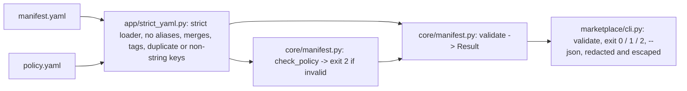

# Design — STORY-B01: manifest validator

Spec: `stories/STORY-B01.md` (R1..R7, P1..P4), cases: `stories/STORY-B01.cases.yaml` (SB1-01..SB1-17).
Level: **medium** — a strict YAML loader in `app/`, one pure module in `core/`, a thin CLI package, samples.
Same shape as the SBOM agent: the file is data, a policy file says what the organisation allows, pure
code decides.

Revised after an adversarial review (six lenses, findings reproduced by verifiers):
`docs/design/STORY-B01-challenge.md`.

## Modules



```text
 manifest.yaml ──┐
                 ├─► app/strict_yaml.py  strict loader ── refuses: aliases, anchors, merge keys,
 policy.yaml ────┘   (size cap, UTF-8)                    custom/implicit-float/date tags, duplicate
                                │                         or non-string keys → R1 finding (exit 1)
                                │                         syntax error, size, encoding → exit 2
                                ▼ plain dicts
              core/manifest.py   check_policy(policy)   → invalid policy → exit 2   (P4)
                                 validate(manifest, policy, manifest_sha256, policy_sha256) → Result
                                   R1 schema + exact types · R2 secrets + vault refs · R3 grammars
                                   R4 data → provider/egress · R5 effects + tool digests · R6 digest/scan
                                   R7 owner/source · tier (P3) · redaction (P2) · hints (P1)
                                ▼
              marketplace/cli.py  validate --manifest --policy [--json] → exit 0 / 1 / 2
```

## Key decisions

- **A strict loader instead of `yaml.safe_load` (R1).** Verified: `safe_load` keeps the last of duplicate keys
  without a word (a `requires_human_approval: false` then `true` reads as `true`), expands a 334-byte alias
  document to 10⁸ strings (11.6 s to walk), applies merge keys, turns `on:` into the key `True`, `1.10` into
  `1.1` and `2026-10-10` into a date, and `!!binary` into bytes. `app/strict_yaml.py` subclasses the
  **pure-Python** `SafeLoader` (the C loader composes in C and would skip the alias guard): it refuses alias
  events at compose time, any tag outside str/int/bool/null/seq/map, merge keys before `flatten_mapping`
  consumes them, non-string keys, and duplicate keys at every level. A refusal is an R1 finding (the
  manifest is unsafe); a syntax error, the size cap or bad encoding is exit 2 (the file is unreadable).
  Each guard has its own canary: turning any one off lets its input through.
- **Exact types.** `type(v) is bool / int / str`, never `isinstance` (`True` is an `int`); counts `>= 0`.
- **Schema as code, one walk, every finding (R1, P1).** A table of fields per object (required, optional,
  type, enum or pattern) walked once; unknown fields are findings; rules run after the schema on whatever is
  there, defensively, so one pass reports everything. A JSON Schema can be exported from the table later for
  editor support; the cross-field and policy rules (R2, R4-R7) cannot be expressed in it.
- **Secrets (R2).** A format check over every key and value (provider key prefixes, PEM headers, `user:pass@`
  in URLs). Paths where a secret was found are remembered, and **every** output goes through one redaction
  step that masks those values wherever they appear (other rules' messages, the JSON). The full scan of the
  asset's code is a scanner stage in Jenkins; this is the manifest-level minimum.
- **Positive grammars (R3, R7).** Resource `^[a-z][a-z0-9-]*:[A-Za-z0-9][A-Za-z0-9._-]*(/[A-Za-z0-9][A-Za-z0-9._-]*)*$`
  plus the policy's forbidden scopes; hosts `^[a-z0-9]([a-z0-9-]*[a-z0-9])?(\.[a-z0-9]([a-z0-9-]*[a-z0-9])?)+$`,
  rejecting all-numeric labels (IP literals); exact set membership, never substring or suffix. Source URL: the
  authority part may not contain `@`, `\`, `%5c` or `:` (verified: Python reads
  `https://evil.com\@bitbucket.example.com/x` as host `bitbucket.example.com`, a WHATWG client as `evil.com`).
  Contact: exactly one `@`, domain matched exactly.
- **Tier (P3)** from fields already in the manifest: 3 if any outward/physical tool or restricted data; 2 if
  any write permission or confidential data; else 1. It drives the human sign-off in the design doc; the
  validator only reports it.
- **Provenance (P3).** The result carries `api_version`, `manifest_sha256` (of the bytes read),
  `policy_sha256`, `validator_version`. Jenkins archives the JSON: that is the record of what was accepted
  under which rules.
- **The policy is validated (P4)** with the same table approach; an invalid policy is exit 2, never defaults.
- **Exit codes**: 0 accept, 1 reject, 2 unreadable manifest or invalid policy.

## What moved out of the manifest, and why

- `lifecycle` (draft/approved/retired) and approvals: registry state set by the sign-off, never by the author.
- The scan block stays, but is written by the scan stage and **bound to the artifact digest**; signed evidence
  in Artifactory, verified by the pipeline, is the target. The validator checks the binding and the numbers.

## File map

```
CREATE: app/strict_yaml.py
CREATE: core/manifest.py
CREATE: marketplace/__init__.py, marketplace/__main__.py, marketplace/cli.py
CREATE: samples/marketplace/policy.yaml, samples/marketplace/manifests/*.yaml (5), samples/marketplace/unsafe/lab-instrument-unsafe.yaml
CREATE: tests/story_b01/{__init__,test_loader,test_validator,test_cli,test_cases_run}.py
MODIFY: scripts/canaries.py (each loader guard, each rule, redaction, tier), pyproject.toml (mypy files += marketplace)
```

## Risks

- Credential formats are a list: a new provider's format is missed until added. The scanner stage over the
  code is the wider net; the schema limits where free text can live.
- The policy is trusted input: whoever edits it decides what is allowed; it is reviewed like code.
- Composition (an agent using a more sensitive MCP server) is invisible to a stateless validator: an
  install-time check in the registry, named in the design doc.
