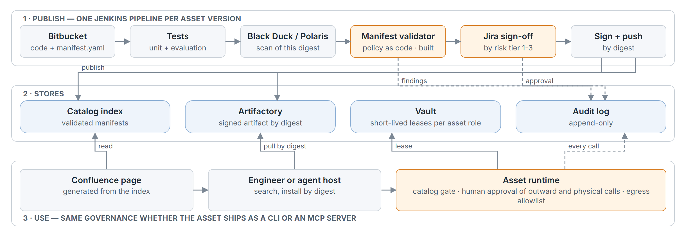

# An internal marketplace for AI assets

**Problem.** Teams build one-off AI helpers (agents, skills, MCP servers) that nobody else can find, trust
or reuse. This design gives every asset one description, one route to publication and one way to be used.
It is built on the tools engineers already have: Jira, Bitbucket, Confluence, Artifactory, Jenkins,
Black Duck/Polaris and Vault.

**Principle.** An asset is trusted for two reasons: it passed checks that a machine runs the same way
every time, and a person signed off on what a machine cannot judge. Being read once by someone is not a
reason.

## 1. Architecture

Source: `architecture.html`.

The orange boxes are where a decision is taken. The validator is the working piece built for this
design. The sign-off is a person. The runtime applies the same rules whether an asset ships as a CLI or as
an MCP server.

## 2. The manifest

Every asset ships a `manifest.yaml` next to its code: it is the asset's contract with the organisation.

| Field | Why it is there |
|---|---|
| `id`, `version`, `kind` (agent, skill, mcp-server, eval-pack), `domains`, `summary` | Identity and discovery. Software, hardware/firmware and simulation assets share one catalog |
| `owner` (team, contact) | Somebody answers for it. An asset without an owner is retired |
| `data.sensitivity` (public, internal, confidential, restricted) | Decides which model providers and hosts the asset may reach. `restricted` (export-controlled) reaches nothing external |
| `model`, `permissions` (`system:scope`, read or write), `egress` | Where prompts go, what the asset touches and where it connects: named precisely, no wildcards |
| `secrets` (`vault://` references) | The credentials it needs, never the credentials themselves |
| `tools` (effect, human approval, definition digest) | Every asset lists them. Each tool **reads**, **writes**, acts **outward** or acts on the **physical** world. Outward and physical calls need a human |
| `artifact` (Artifactory ref and sha256), `source` | Exactly what is installed and the repository it is built from |
| `security_scan` | Written by the scan stage, not by the author, and bound to the artifact's digest |

The author cannot write whether the asset is approved, or who approved it: that is registry state, set by
the sign-off.

The `effect` vocabulary matters most here. An MCP server that drives an RF bench declares its
`set_output_power` tool as `physical`. The validator refuses it unless a human approves each call. If a
manifest writes to a lab system but declares no physical tool, the validator rejects it.

## 3. Publishing and trust

**Policy as code.** A policy file is reviewed like code. It says which providers and hosts each
sensitivity may reach, which systems are physical, which scopes are forbidden, and the scan thresholds.

The validator (`python -m marketplace validate`, in this repo) applies that policy in Jenkins.
- **What it rejects:** a manifest that holds a secret, uses a wildcard, sends data where its sensitivity
  forbids, lets an outward or physical effect run without a human, is not pinned and scanned, or has no
  accountable owner.
- **How it reads:** a strict YAML subset. Duplicate keys, aliases, merge keys and tags are refused,
  because each one let two readers see two different manifests.
- **What it reports:** every finding at once, each with a hint for the fix. It never echoes a secret.
- **What it records:** the digests of the manifest, the policy and the validator. Jenkins archives them as
  the record of what was accepted under which rules.

**Human sign-off by risk tier.** The validator computes the tier, and the pipeline opens the Jira ticket:

| Tier | What puts an asset there | Who signs |
|---|---|---|
| 1 | read-only tools, public or internal data | the owner's lead (fast path) |
| 2 | write tools, or confidential data | + a platform reviewer |
| 3 | outward or physical effects, a write to a physical system, or restricted data | + security; for physical effects, the lab safety owner |

**Approval is bound to content.** The approval records the digests of the manifest and the artifact. A new
prompt, a new tool or a changed definition is a new version, and it goes through the gate again.

**Operating the catalogue.**
- **The format changes:** the validator accepts the current and the previous `apiVersion`.
- **The policy tightens:** the whole catalogue is re-validated. A newly failing asset is marked
  `non-compliant until <date>` before it is revoked.
- **A team needs an exception:** a waiver is its own reviewed record, with an expiry and the asset's
  digest. A secret inside a manifest can never be waived.

**Retiring.** An asset is deprecated, then retired, in any of these cases:
- its owner leaves without a successor;
- its scan turns red and is not fixed in time;
- nobody has used it for two quarters.

Retired assets stay in the index for audit, but cannot be installed.

## 4. Using an asset

1. **Find.** Each asset has a Confluence page generated from its validated manifest, so the page cannot
   claim what the manifest does not. Search is by domain, kind and data tier, through one entry point:
   agents query the catalog, they do not load a list of every asset.
2. **Install.** `ai-assets install <id>@<version>` pulls the artifact by digest from Artifactory, checks
   its signature, and refuses anything that is not approved.
3. **Access and secrets.** The asset runs under a Vault role named after it. It gets short-lived leases
   only for the `vault://` paths its manifest declares. When it acts for a person (the test-plan agent
   reading that engineer's Jira), the lease is that person's delegated token, not a shared account.
   Revoking the role revokes the asset everywhere.
4. **Run.** Each asset's `tools` list is its catalog of actions; nothing outside it runs. From that one list
   the platform generates a CLI, an MCP `tools/list` or a `SKILL.md`, all carrying the same definition
   digests. The checks live in the **asset runtime**, which the platform owns, behind the catalog:
   - only calls in the catalog run;
   - outward and physical calls wait for a human, who approves outside the agent's channel, for that
     exact call;
   - identity comes from the login, never from an argument;
   - egress is limited to the declared hosts;
   - every call is logged.

**CLI or MCP server?** It depends on the asset:
- **CLI** for an asset that holds no state and is used on demand (triaging one scan).
- **MCP server** for an asset that holds a session or a lock (an RF bench, a simulation job that runs for
  hours), and for clients without a shell.

Context cost does not decide it any more: in 2026, Claude Code, Cursor and Codex load only tool names
at the start. What does decide it is that a CLI must never be reached through a general shell, because
arguments to an allowed command can still run code. And a digest of the tool *definitions* does not cover
the code behind them, so a remote server must attest what it runs.

**Combinations.** An agent that uses an MCP server cannot be less sensitive than the data that server
returns. The registry checks this at install, because a single manifest cannot see it.

## 5. Value: what we measure to keep an asset

A value the author declares is a claim; measured use is evidence.

| Measure | Source | Why |
|---|---|---|
| Teams and engineers using it per month | install and runtime logs | reuse is the point |
| Accepted outcomes (test plan merged, triage confirmed) | the asset's success signal, declared at publish | use without acceptance is noise |
| Cost per accepted outcome | runtime metering | two assets for the same job can be compared |
| Incidents and human overrides | audit log | trust falls before usage does |
| Time to approve | Jira | the gate must not become the reason to skip it |

Assets below threshold for two quarters are proposed to their owner for retirement.

## 6. Bring your own: an evaluation pack

**What it is.** A set of engineering tasks with executable checks (hidden tests, numeric references),
packaged as an asset. Examples: SCPI instrument drivers, test plans from Jira stories, simulation job
scripts.

**Why it belongs here.** Every other asset claims to save time; the evaluation pack is how that claim is
measured. It is also how a model or tool change is checked before rollout.

**Who uses it.**
- Asset owners, to show their asset still works after a model update.
- The platform team, to catch provider regressions.
- Engineering leads, to choose between assets with error bars, not anecdotes.

Its `kind: eval-pack` has two rules: it calls no model, and it has no outward or physical tool.

## 7. Standards, and what is built

**Standards.** No 2026 descriptor (MCP `server.json`, Agent Skills `SKILL.md`, A2A agent cards) carries
sensitivity, egress, permissions or tool effects. So the governance manifest stays our own, made
compatible with them:
- ids follow the `SKILL.md` name rule;
- the registry can expose the MCP Registry API;
- the fields export as JSON Schema;
- the rules can move to OPA when Security owns them.

**Built and tested:** the validator.
- A policy, five sample manifests (the four from the brief and the evaluation pack), and one unsafe
  manifest for the demo.
- Every rule seen failing.
- Two adversarial reviews, recorded in `docs/design/`.

**Described, not built:** the registry and sign-off flow, the asset runtime, signed scan evidence,
re-validation and waivers, and the usage dashboards.
