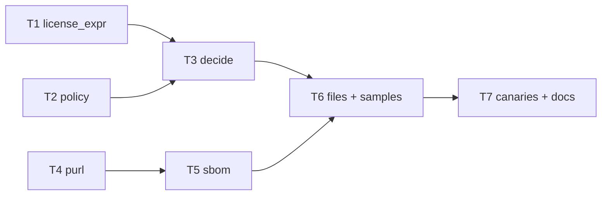

# Tasks — STORY-001

Design: `docs/design/STORY-001.md`. Every task is red → green → commit, and names the cases it closes.
Verification for all: `uv run pytest` green and `python scripts/canaries.py` with 0 survivors.



```text
 T1 license_expr ─┐
                  ├─► T3 decide ─────────┐
 T2 policy ───────┘                      ├─► T6 files + samples ─► T7 canaries + docs
 T4 purl ──────────► T5 sbom ────────────┘
```

Parallel frontier: {T1, T2, T4}. Critical path: T4 → T5 → T6 → T7.

## T1 — License expression parser
- Files: `core/license_expr.py`, `tests/story_001/test_license_expr.py`
- Closes: S1-08, S1-11 (operator case), S1-12 (precedence), grammar part of S1-13
- Done when: `WITH` and `+` stay inside the leaf; every parse error says what and where
- Depends on: none

## T2 — Policy
- Files: `core/policy.py`, `tests/story_001/test_policy.py`
- Closes: S1-19 (contradictory policy), case-insensitive lookup part of S1-11
- Done when: the same id in two lists, or a non-string entry, raises `PolicyError` naming it
- Depends on: none

## T3 — Decide
- Files: `core/decide.py`, `tests/story_001/test_cases.py` (license-only cases)
- Closes: S1-01..S1-07, S1-10, S1-13, S1-14
- Done when: OR = best, AND = worst, the winning reason is kept, a `ParseError` becomes `Needs review`
- Depends on: T1, T2

## T4 — Purl
- Files: `core/purl.py`, `tests/story_001/test_purl.py`
- Closes: purl rows of S1-18
- Depends on: none

## T5 — SBOM parsing (CycloneDX + SPDX)
- Files: `core/sbom.py`, `tests/story_001/test_sbom.py`
- Closes: S1-15, S1-16, S1-17, external-reference and SPDX rows of S1-18, format rows of S1-19
- Done when: unknown format and deep nesting raise `FormatError`; AI models detected per DR-6
- Depends on: T4

## T6 — File adapter and samples
- Files: `app/files.py`, `samples/policy.yaml`, `samples/sbom.cdx.json`, `samples/sbom.spdx.json`, `tests/story_001/test_samples.py`
- Closes: S1-09, invalid-JSON row of S1-19
- Done when: both samples yield the same 12 components (≥2 AI models) with the same verdicts; size caps enforced
- Depends on: T3, T5

## T7 — Canaries and docs
- Files: `scripts/canaries.py`, `AGENTS.md` (layout: `app/`, `docs/`), `STATED.json`
- Mutations: AND/OR precedence swap, OR→min, missing license → Allow, strip `WITH` before lookup
- Depends on: T6

## Status

| Task | State | Commit |
|---|---|---|
| T1 | todo | |
| T2 | todo | |
| T3 | todo | |
| T4 | todo | |
| T5 | todo | |
| T6 | todo | |
| T7 | todo | |
