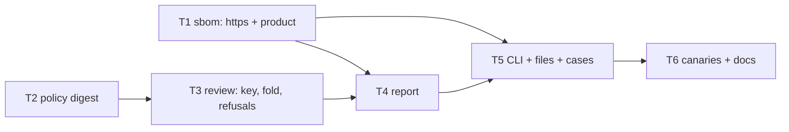

# Tasks — STORY-003

Design: `docs/design/STORY-003.md`. Every task is red → green → commit, and names the cases it closes.
Verification for all: `uv run pytest` green, `uv run ruff check .`, `uv run mypy`, and
`python scripts/canaries.py` with 0 survivors. The STORY-001 suite stays green and unchanged.



```text
 T1 sbom: https + product ──────────────────────┬─► T4 report ─► T5 CLI + files + cases ─► T6 canaries + docs
 T2 policy digest ─► T3 review: key, fold ──────┘                  ▲
                                                 T1 ───────────────┘
```

Parallel frontier: {T1, T2}. Critical path: T2 → T3 → T4 → T5 → T6.

## T1 — Parser: `https`-only source link, and the product exposed
- Files: `core/sbom.py`, `tests/story_003/test_render.py` (https rows), `stories/STORY-001.md` (DR-7 note)
- Closes: S3-10 (parser part), S3-12 (parser part)
- Done when: a non-`https` candidate is skipped and the next one is tried; `read_sbom` returns
  `SbomDocument(components, product)`; `parse_sbom` keeps its signature; STORY-001 suite green
- Depends on: none

## T2 — Policy digest
- Files: `core/policy.py`, `tests/story_003/test_cases.py` (digest unit)
- Closes: the policy part of S3-09
- Done when: reordering a section or changing case does not change `Policy.digest()`; moving an id
  between sections does
- Depends on: none

## T3 — Review rules: decision key, fold, refusals
- Files: `core/review.py`, `tests/story_003/test_cases.py`
- Closes: S3-01, S3-02, S3-03, S3-06, S3-07, S3-08 (logic, on in-memory ledger lines)
- Done when: the key changes with license, source or policy digest; the latest reviewer line wins;
  blank `by`/`reason`, an unknown verdict or an unknown decision raise `ReviewError`
- Depends on: T2

## T4 — Report: build, escape, Markdown
- Files: `core/report.py`, `tests/story_003/test_render.py`
- Closes: S3-04, S3-11, S3-12 (rendering)
- Done when: the Markdown table has one row per component whatever the text holds, no control or
  format character reaches the output, the JSON keeps the raw text, the product line is present
- Depends on: T1, T3

## T5 — CLI, file adapter and the cases end to end
- Files: `review/__init__.py`, `review/__main__.py`, `review/cli.py`, `app/files.py`,
  `tests/story_003/__init__.py`, `tests/story_003/test_cases.py`
- Closes: every S3 case through `main(argv)` on a temp ledger; S3-05 and S3-09 only exist here
- Done when: refusals exit 2 and write nothing; `report` before `scan` exits 2; a second scan adds no
  decision line and the second `report.json` equals the first except `generated_at`; one subprocess
  smoke test runs `python -m review`
- Depends on: T1, T2, T3, T4

## T6 — Canaries and docs
- Files: `scripts/canaries.py`, `DOCTRINE.md` (D-08), `AGENTS.md` (review command), `STATED.json`
- Mutations: drop license from the key; drop the policy digest from the key; accept any URL scheme;
  drop the control-char escape; drop the `|` escape; drop the blank-reviewer check; drop the
  decision-exists check; first reviewer line wins; scan always appends; `product=None`
- Depends on: T5

## Status

| Task | State | Commit |
|---|---|---|
| T1 | done | f4aa7e5 |
| T2 | done | 2259cb2 |
| T3 | done | 20007fa |
| T4 | done | 76077a0 |
| T5 | done | 0bfdbc2 |
| T6 | done | this commit |
