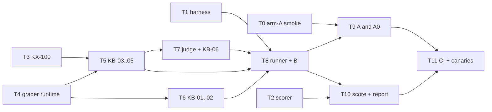

# Tasks — STORY-004 (KeysBench)

Design: `docs/design/STORY-004.md`. Every task is red → green → commit, and names the cases it closes.
Verification for all: `uv run pytest` green, `uv run ruff check .`, `uv run mypy`, and
`python scripts/canaries.py` with 0 survivors. The STORY-001..003 and B01 suites stay green and unchanged
(the STORY-002 recordings keep their keys).



```text
 T0 arm-A smoke ─────────────────────────────────────────────────────┐
 T1 harness ──────────────────────────────┐                          ▼
 T3 KX-100 ─┬─► T5 KB-03..05 ─► T7 judge ─┼─► T8 runner + B ─► T9 A, A0 ─┐
 T4 graders ┴─► T6 KB-01, 02 ─────────────┘          │                   ├─► T11 CI + canaries
 T2 scorer ──────────────────────────────────────────┴─► T10 score ──────┘
```

Parallel frontier: {T0, T1, T2, T3, T4}. Critical path: T4 → T5 → T7 → T8 → T9 → T11.

## T0 — Arm-A smoke on Windows (live, cents)
- Files: `docs/design/STORY-004.md` § Verified (the measured facts)
- Closes: the two points the design left to the pilot (smallest environment, `--restricted` behaviour)
- Done when: one `claude --restricted --bare -p` call on a one-file task has shown which environment it
  needs, that user settings do not apply, that no user env name reaches a `python` subprocess, that a
  non-`python` command is refused, that `--max-budget-usd` holds, and what the stream-json lines look like
- Depends on: none

## T1 — Harness for benchmarking
- Files: `harness/{gate,providers,loop}.py`, `tests/story_004/{test_gate_relative,test_usage_prices,test_latency}.py`
- Closes: S4-02 (rest), S4-03, the path half of S4-12
- Done when: `Gate(base=W)` allows `driver.py` and denies `../x` and absolute paths; the streaming
  provider returns `_call {latency_s, ttft_s, request_id}` and never retries; `Agent(effort, cache)`
  sends both, with `cache` off by default; `run_end` has `latency_s` as the sum of call latencies and a
  separate `wall_s`; the STORY-002 recordings still replay
- Depends on: none

## T2 — Pure scorer
- Files: `core/bench_score.py`, `tests/story_004/test_score.py`
- Closes: S4-09, S4-10, S4-13, S4-14, S4-15 (aggregation), S4-19
- Done when: every number in those cases matches; `core/` still imports only the standard library
- Depends on: none

## T3 — KX-100 instrument
- Files: `keysbench/instrument/{sim.py,MANUAL.md}`, `tests/story_004/test_instrument.py`
- Closes: (feeds KB-03..06)
- Done when: the simulator answers the documented commands deterministically for a seed, queues errors
  for `SYST:ERR?`, returns the previous value on `FETC?` without `INIT`, and the manual's specification
  table and limit lines are what KB-04 and KB-05 cite
- Depends on: none

## T4 — Grader runtime
- Files: `keysbench/graders.py`, `tests/story_004/test_graders.py`
- Closes: S4-06
- Done when: only declared files reach the grading directory; a missing or partial junit report is a
  fail; the grading environment holds no credential; contestant code is called in a subprocess
- Depends on: none

## T5 — Domain tasks KB-03, KB-04, KB-05, and `check-graders`
- Files: `keysbench/tasks/KB-0{3,4,5}/…`, `keysbench/cli.py` (`check-graders`), `tests/story_004/test_check_graders.py`
- Closes: S4-05 rows KB-03, KB-04, KB-05
- Done when: each solution scores 1 and the base, the antipattern and every hack score 0
- Depends on: T3, T4

## T6 — History tasks KB-01, KB-02
- Files: `keysbench/extract.py`, `keysbench/tasks/KB-0{1,2}/…`
- Closes: S4-05 rows KB-01, KB-02
- Done when: `extract.py` rebuilds both tasks from their fix commits; only tests that fail on the parent
  are kept; solution 1, everything else 0
- Depends on: T4

## T7 — Judge and KB-06
- Files: `keysbench/judge/{prompt.md,rubric-kb06.toml}`, `keysbench/tasks/KB-06/…`, `keysbench/graders.py`
  (judge), `prompts/approved.jsonl`, `tests/story_004/test_judge.py`
- Closes: S4-05 row KB-06, S4-07, the judge half of S4-08
- Done when: a quote not in the review, or not at the planted line, fails; the judge never runs on the
  contestant's model; model names are masked; the verdict carries the prompt, rubric and artifact
  digests; the three `check-graders` judge calls are recorded once and replayed
- Depends on: T5

## T8 — Runner and configuration B
- Files: `keysbench/{cli,contestants}.py`, `keysbench/plans/2026-10.yaml`, `tests/story_004/test_runner.py`
- Closes: S4-01 (B), S4-04 (refused, truncated), S4-11, S4-12, S4-18
- Done when: rounds, resume and the per-call budget reservation behave as the cases say; three recorded
  attempts replay as three attempts; an unrecorded request stops the run; `--live` without a key exits 2
- Depends on: T1, T5, T6, T7

## T9 — Configurations A and A0
- Files: `keysbench/contestants.py`, `keysbench/arm_a/settings.json`, `tests/story_004/test_arm_a_audit.py`
- Closes: S4-01 (A), S4-04 (invalid), S4-17
- Done when: the command carries the restricted flags and the right tools per configuration; the audit
  marks any path outside the workspace `invalid`; cost comes from the CLI's usage; offline, the stored
  changed files are graded again
- Depends on: T0, T8

## T10 — `score` and the report
- Files: `keysbench/cli.py` (`score`), `keysbench/report.py`, `tests/story_004/test_report.py`
- Closes: S4-08 (no network in score), S4-15 (digests), S4-16, S4-19 (memo in the report)
- Done when: `results.json` is raw with its input digests; `results.md` opens with the decision memo and
  escapes contestant text; scoring twice gives the same bytes
- Depends on: T2, T8

## T11 — CI, canaries and guards
- Files: `scripts/canaries.py`, `scripts/ci.sh`, `pyproject.toml`, `tests/story_004/test_collection.py`
- Closes: S4-05 in CI, the "seen failing" half of every grader family
- Done when: one canary per grader family, plus scorer, budget, gate and usage canaries, all killed;
  `ci.sh` runs `check-graders` and the leak gate; nothing under `keysbench/tasks/` is collected, linted
  or type-checked
- Depends on: T9, T10

## After the build (not tasks of this file, but gates before any money is spent)

1. Adversarial review of the code (six lenses, findings reproduced), CONFIRMED fixes applied test first.
2. The account is topped up; the run cap is the lower of 60 USD and the balance.
3. Pilot: KB-03 × four models × B, A0, A, one attempt. Projection from measured cost. Reduction order if
   the projection is above the cap, decided before the run: Fable 5.1 at k = 1; then A and A0 at k = 1;
   then everything at k = 1.
4. Full grid, in rounds, resumable; ledger, recordings and results committed.
