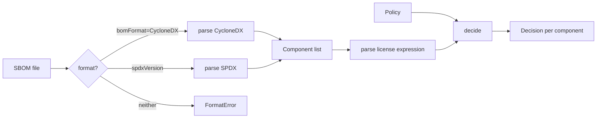

# STORY-001 — Parse the SBOM and classify each component's license against the policy

**As** a Legal reviewer preparing CRA documentation
**I want** every component of an SBOM classified against our license policy
**so that** I only look at the components that need a human.

## Scope

- Input: an SBOM in CycloneDX JSON (1.5/1.6) or SPDX JSON (2.3). Both formats produce the same
  component list.
- Policy: a file listing which SPDX license ids are `allowed`, `review` or `rejected`.
- Output per component: `Allow`, `Needs review` or `Reject`, with the reason and a link to the
  component's source.

**Why deterministic, not a model:** this story only answers syntactic questions (is this id in
the list? how does this expression parse?). The answer is exact, cheap and must never vary. The
model comes in at STORY-002, where the license lives in prose.

## Flow



```text
 SBOM file ──► format? ──CycloneDX──► parse CycloneDX ─┐
                  │                                     ├──► components ──► parse expression ─┐
                  ├──────SPDX───────► parse SPDX ──────┘                                      ├──► decide ──► Decision
                  └──neither──► FormatError                                    Policy ────────┘
```

## Interface contract

```
parse_sbom(document: dict) -> list[Component]          raises FormatError
Component  { ref, name, version, type, purl, license_expression | None, source_url | None, is_ai_model }
Policy.from_dict({allowed: [...], review: [...], rejected: [...]})   raises PolicyError
decide(component, policy) -> Decision { verdict, reason, source_url | None }
verdict ∈ { "Allow", "Needs review", "Reject" }
```

`core/` receives already-loaded `dict`s: reading files and YAML happens outside the pure core.

## Domain rules

- **DR-1 Fail closed.** Missing, unknown, custom or unparseable → `Needs review`. Never `Allow`.
- **DR-2 Expression grammar (SPDX 2.3.1 Annex D).** Precedence `+` > `WITH` > `AND` > `OR`;
  parentheses override. Operators match case-sensitively (uppercase only); license ids match
  case-insensitively.
- **DR-3 Combining.** Ranking `Allow` > `Needs review` > `Reject`. `OR` takes the best branch,
  `AND` the worst.
- **DR-4 No inference.** `X WITH Y` and `X+` are looked up as written; if the policy does not list
  them, `Needs review`. `LicenseRef-*` and name-only licenses are `Needs review` (custom license)
  unless the policy lists them.
- **DR-5 Format mapping.**
  - CycloneDX: several entries in `licenses` are combined with `AND`; an `expression` entry is used
    as is; nested `components` are flattened. CycloneDX 1.6 marks entries with
    `acknowledgement: declared | concluded`; when any entry is `concluded`, only the concluded ones
    count (the same rule as SPDX below: a verified conclusion overrides an author's declaration).
  - SPDX: `licenseConcluded`, falling back to `licenseDeclared`; `NOASSERTION` and `NONE` mean no
    license declared.
- **DR-6 AI models.** CycloneDX `type: machine-learning-model`; SPDX 2.3 has no such purpose, so a
  `pkg:huggingface/` purl marks the model.
- **DR-7 Source link.** First available of: `vcs` > `source-distribution` > `distribution` > `website` external reference >
  URL derived from the purl (pypi, npm, maven, github, huggingface) > SPDX `downloadLocation` /
  `homepage` (unless `NOASSERTION`/`NONE`) > none. A missing link adds `no source declared` to the
  reason and does not change the verdict.
- **DR-8 Errors are loud.** Invalid JSON, an unknown format, or a policy listing the same id twice
  raise an error; they never yield an empty result.

## Acceptance Criteria

- [x] A component under an allowed license is `Allow` (case: S1-01)
- [x] A component under a rejected license is `Reject` (case: S1-02)
- [x] A component under a review license is `Needs review` (case: S1-03)
- [x] A component with no declared license is `Needs review`, never `Allow` (case: S1-04)
- [x] A license id the policy does not list is `Needs review` (case: S1-05)
- [x] `OR` takes the best allowed option (case: S1-06)
- [x] `AND` takes the strictest option (case: S1-07)
- [x] An expression that cannot be parsed is `Needs review` (case: S1-08)
- [x] The CycloneDX and SPDX samples yield the same components, at least 10, at least 2 AI models (case: S1-09)
- [x] Every decision carries a source link, or says that none was declared (case: S1-10)
- [x] License ids match case-insensitively; operators only in uppercase (case: S1-11)
- [x] `AND` binds tighter than `OR` without parentheses (case: S1-12)
- [x] `WITH` and `+` are looked up as written, never inferred (case: S1-13)
- [x] `LicenseRef-*` is `Needs review` unless the policy lists it (case: S1-14)
- [x] Several CycloneDX license entries combine with `AND` (case: S1-15)
- [x] SPDX uses `licenseConcluded`, then `licenseDeclared`; `NOASSERTION`/`NONE` is no license (case: S1-16)
- [x] Nested CycloneDX components are flattened (case: S1-17)
- [x] The source link follows the DR-7 priority, including links derived from the purl (case: S1-18)
- [x] Invalid JSON, unknown format and a contradictory policy raise errors (case: S1-19)
- [x] A CycloneDX `concluded` license overrides the `declared` ones (case: S1-20)

## Out of scope

AI model cards (STORY-002), human review and the report (STORY-003).
