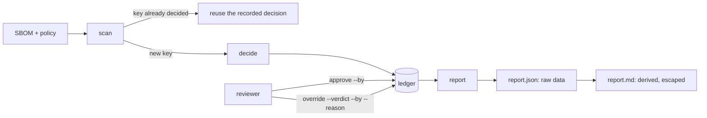

# STORY-003 — Reviewer approve/override, an audit log, and an exported report

**As** a Legal reviewer
**I want** to approve or override any decision, with every step logged
**so that** the CRA file shows who decided what, when and why.

## Scope

- `review` command: list pending items, approve one, or override it with a new verdict.
- Every decision and every override is a ledger line (DOCTRINE D-06). An override points at the
  decision it replaces and needs a reviewer name and a reason.
- `report` command: a short Markdown summary Legal can attach (counts, per-component verdict,
  reason, source link, overrides), plus the same data as JSON.
- A re-run reads the recorded verdicts instead of deciding again, so the report is stable.
- The report always names the package left out as "the product" (STORY-001 DR-9), so nothing
  leaves the review silently.

**Why deterministic, not a model:** every step here is bookkeeping (who said what, which line
replaces which, how to print it). There is nothing to judge; the human is the judge. The model
stays in STORY-002.

## Flow



```text
 SBOM + policy ──► scan ──key seen?──yes──► reuse recorded decision
                            │
                            └──no──► decide ──► ledger (append-only) ◄── approve --by
                                                     │               ◄── override --verdict --by --reason
                                                     ▼
                                                  report ──► report.json (raw) ──► report.md (escaped)
```

## Interface contract

Non-interactive: every command takes flags only, so tests and a live demo drive it the same way.

```
scan     --sbom PATH --policy PATH --ledger PATH            -> decisions recorded or reused, one line per component
list     --ledger PATH                                      -> pending items (decision with no reviewer line)
approve  --ledger PATH --decision ID --by NAME [--reason TEXT]
override --ledger PATH --decision ID --verdict VERDICT --by NAME --reason TEXT
report   --sbom PATH --policy PATH --ledger PATH --out DIR  -> DIR/report.json, DIR/report.md
VERDICT ∈ { "Allow", "Needs review", "Reject" }
exit code 0 on success; 2 on a refused command, with the reason on stderr; nothing is written on refusal
```

Report JSON (the data; the Markdown is derived from it):

```
{ generated_at, sbom_sha256, policy_sha256,
  product: { name, version } | null,          // null -> "every package reviewed"
  counts: { "Allow": n, "Needs review": n, "Reject": n, "pending": n },
  components: [ { identity, name, version, verdict, decided_verdict, reason, source_url | null,
                  status: "pending" | "approved" | "overridden", decision_id,
                  reviews: [ { kind, by, reason, verdict, at } ] } ]   // sorted by identity
}
```

## Domain rules

- **DR-1 History, not state.** A decision, an approval and an override are each a new ledger
  line. Nothing is edited or deleted. A reviewer line points at a decision id that exists.
- **DR-2 Who and why.** `approve` needs `--by`; `override` needs `--by`, `--reason` and one of the
  three verdicts. Blank (or whitespace-only) values are refused. The name is recorded as given:
  there is no authentication (see Limits).
- **DR-3 Final verdict.** The final verdict of a component is the verdict of the latest reviewer
  line on its decision; with none, the decided verdict, and its status is `pending`. Every
  reviewer line is listed in the report, not only the latest.
- **DR-4 Frozen decisions, and what "the same" means (security review C12).** A decision is
  reused only when the key matches: the component identity **and** its license expression **and**
  its source link **and** the sha256 of the policy as loaded. Identity alone is not enough: two
  packages with the same name and version but different licenses would share one verdict, and a
  policy edit would be ignored on a re-run.
- **DR-5 A new policy reopens the item.** When the policy changes, the key changes, so the
  component is decided again and the old override does not carry over: the item is `pending`
  again. A reviewer sees it once more; the alternative is an `Allow` the current policy never
  produced.
- **DR-6 Only `https` is a source link (security review C5).** A source whose scheme is not
  `https` (`javascript:`, `file:`, a UNC path `\\host\share`, `http:`, anything else) is treated as
  no source declared. The report never renders a link it would not open itself.
- **DR-7 Escape when printing, not in the data (security review C4).** Component text comes from
  the SBOM and is data. The JSON carries it raw. The Markdown and the terminal output escape it:
  no control character reaches the output (shown as `\uXXXX`), and a name holding `|`, a newline, a
  backtick or `](https://…)` stays inside its own table cell.
- **DR-8 The product is named.** The report names the package STORY-001 DR-9 left out as the
  product (`name@version`). If there was no single product, it says every package was reviewed.
  Counts cover the reviewed components only, and the report says so.
- **DR-9 Stable report.** A second `scan` of the same SBOM with the same policy adds no decision
  line, and the second `report.json` is identical to the first except `generated_at`.

## Limits

- The reviewer name is trusted as typed. Tying it to an identity (SSO, a signed commit) is the
  next step, not this story.
- The ledger is not tamper-evident (no hash chain). It is append-only by convention and by code.
- An `approve` line records who and when; the verdict it approved is recomputed when the ledger is
  replayed and shown in the report. The report, not the raw JSONL, is the artifact Legal reads.

## Acceptance Criteria

- [x] An override is a new ledger line; the original decision stays (case: S3-01)
- [x] An override without a reviewer or a reason is refused (case: S3-02)
- [x] The report shows the final verdict after overrides and lists each override (case: S3-03)
- [x] The report has counts per verdict and a source link per component (case: S3-04)
- [x] Running the review twice on the same SBOM reuses the recorded verdicts (case: S3-05)
- [x] An override of an unknown decision, or to a verdict that does not exist, is refused (case: S3-06)
- [x] Approve needs a reviewer; an approved item is no longer pending (case: S3-07)
- [x] Two components with the same identity and different licenses get separate decisions (case: S3-08)
- [x] A policy change decides again and the old override does not carry over (case: S3-09)
- [x] A source that is not `https` is reported as none declared (case: S3-10)
- [x] SBOM text with control characters or Markdown syntax cannot break the report (case: S3-11)
- [x] The report names the product left out, or says every package was reviewed (case: S3-12)
