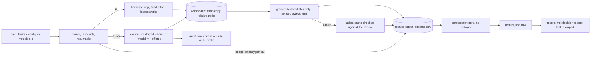

# STORY-004 — KeysBench: a monthly measurement of frontier models on software-engineering tasks

**As** the person who decides which AI coding contracts an engineering organisation renews
**I want** each month's frontier models measured on our kind of engineering work, with cost and latency
**so that** a contract decision rests on a measurement with its error bars, not on a public leaderboard.

> Revised after an adversarial design review (six lenses, every finding verified by a second agent
> that tried to refute it). What changed and why: `docs/design/STORY-004-challenge.md`.

## Scope

- Six tasks in the shape of test-and-measurement software work, each with an **executable oracle**
  (hidden tests, a numeric reference, or a structured answer checked by code). The one property a
  test cannot see (whether a code review found the defect) is scored by a judge whose evidence is
  checked by code.
- Three contestant configurations, the same four models (Claude Fable 5.1, Opus 5.5, Sonnet 5.5,
  Haiku 5.5), the same fixed `effort`:
  - **B, baseline**: this repo's `harness/` with list/read/write tools and no code execution.
  - **A, product harness**: the Claude Code CLI with file tools and Python.
  - **A0, product harness without execution**: the same CLI with file tools only.
  - The report gives **A0 − B** (what the product scaffold adds) and **A − A0** (what running code
    adds) per model. One "A − B" would mix the two.
- Three attempts per (task, configuration, model), run in rounds (every cell's attempt 1, then
  every cell's attempt 2…), so a budget stop leaves every contestant with the same number of
  attempts.
- A runner that records, a pure scorer, and a report whose first section is a **decision memo**
  computed from the ledger: per-task results with cost per pass and latency, the tasks every
  contestant solves (commodity) with the cheapest one that does, a failure taxonomy, and how many
  tasks a decision-grade month would need and what it would cost at this run's measured prices.
- Codex CLI and Cursor agent are written as a protocol (same tasks, same graders, metered cost),
  listed as not run with the concrete reason.

**Why AI-first, and where the code decides:** the contestants are models; the judge is a model only
where a test cannot see. Everything that can be checked by running code is checked by running code,
the judge's evidence is checked by code against the artifact it must come from, and its verdict is
frozen on the attempt line.

**What it is not:** a ranking. Six tasks cannot separate frontier models that public benchmarks place
within two points of each other. The deliverable is the **instrument**: tasks with oracles, graders
seen failing (including against reward hacking), a cost ledger, and a report that says what it can
and cannot conclude, and what it would take to conclude more.

## Tasks

Two tracks. **History**: real fixes from this repository's own history, extracted the way a monthly
feed would extract them from an organisation's repositories (the parent tree without history, the
issue in prose, the tests the fix added as hidden tests). **Domain**: a fictitious instrument written
for this benchmark (a simulated SCPI power meter with a short manual): public-shaped (SCPI, GUM) but
not in any training set.

| Id | Track | Task | Oracle |
|---|---|---|---|
| KB-01 | history | Fix the reported crash on deeply nested license expressions | the tests the real fix added, which fail on the parent tree |
| KB-02 | history | Fix the reported SBOM nested-components problem | the tests the real fix added, which fail on the parent tree |
| KB-03 | domain | Write the driver function that configures the meter and reads one power value, from the manual alone | hidden tests against the simulator |
| KB-04 | domain | Uncertainty budget (GUM, first order) for a power reading, from the manual's specification table | numeric reference with a tolerance |
| KB-05 | domain | A requester asks for a resolution the manual says the meter cannot give; the correct answer declines and quotes the limiting line | structured answer: not feasible, and the quote contains a declared limit line |
| KB-06 | domain | Review a small driver change with one planted defect | rubric scored by the judge; the evidence must be in the contestant's review and point at the planted line |

## Flow



```text
 plan (tasks × configs × models × k) ──► runner (rounds, resumable)
     │ B ──► harness/ loop, fixed effort, list/read/write ──────────────┐
     │ A, A0 ──► claude --restricted --bare -p --model --effort ──┐     ├─► workspace W (temp copy, relative paths)
     │                                                            └─► audit: access outside W ─► invalid
     ▼                                                                   │
 usage + latency per call ──────────────────────────────► grader (declared files only, isolated pytest, junit)
                                                                         │ KB-06 only
                                  results ledger (append-only) ◄── judge (quote must be in the review)
                                           │
                                           ▼
                    core scorer (pure, no network) ──► results.json (raw) ──► results.md (memo first, escaped)
```

## Interface contract

```
keysbench run    --plan PATH --out DIR [--live] [--budget-usd N]   -> one ledger line per attempt; resumes
keysbench score  --ledger PATH --out DIR                           -> DIR/results.json, DIR/results.md; no network
keysbench check-graders                                            -> each grader against its solutions
--live      calls the models (needs ANTHROPIC_API_KEY); without it the runner replays recordings
--budget-usd  hard cap for the run; default 60
exit 0 on success; 2 on a refused command (unknown task, a model with no price, a projected run above
the cap, the cap reached before the first call, --live without a key), with the reason on stderr
```

Attempt line (ledger):

```
{ kind: "attempt", task_id, task_sha256, family, config: "A" | "A0" | "B",
  contestant: { model, effort, harness, harness_version }, attempt: 1..k,
  outcome: "pass" | "fail" | "refused" | "truncated" | "invalid" | "error" | "budget_stopped",
  calls: [ { request_id, latency_s, ttft_s | null, retries, usage: { input, cache_write_5m, cache_write_1h,
             cache_read, output, thinking }, inference_geo } ],
  cost_usd: number | null, cost_basis: "measured-usage" | "cli-usage" | "unpriced",
  latency_s, wall_s, grader: { name, failed_checks: [id] }, judge: { model, verdict, review_quote,
  quote_in_review, points_at_defect, prompt_sha256, rubric_sha256, artifact_sha256 } | null, at }
```

Results JSON:

```
{ benchmark: "keysbench-2026.10", generated_at, prices_checked_on, tasks: n,
  inputs: { ledger_sha256, recordings_sha256: { path: sha256 } },
  ranking: "none: n <= 8 tasks",
  memo: { per_task: [ { task_id, config, model, passes, attempts, cost_per_pass | null, latency_p95_s } ],
          commodity: [ { task_id, config, cheapest_passing_model, cost_per_pass } ],
          failure_modes: [ { mode, task_id, config, model, count } ],
          decision_grade: { discordance_rate, tasks_needed_for_15_points, est_cost_usd | null, note } },
  cells: [ { task_id, task_sha256, config, model, effort, attempts, passes, wilson_95: [lo, hi],
             pass_hat_k, any_pass, cost_usd_total | null, cost_per_pass | null,
             latency_median_s, latency_p95_s, saturated, invalid } ],
  by_contestant: [ { config, model, effort, mean_task_pass_rate, task_clustered_95: [lo, hi],
                     cost_per_pass, latency_median_s, latency_p95_s } ],
  deltas: [ { model, kind: "A0-B" | "A-A0", mean_paired_difference, task_clustered_95: [lo, hi], tasks } ],
  not_run: [ { contestant, reason } ] }
```

## Domain rules

- **DR-1 The unit is (configuration, model, effort).** Every row names all three, plus the harness
  version. A result is never attributed to "the model" alone.
- **DR-2 Effort is fixed and sent.** Every request carries the same explicit effort (the API
  parameter in B, the CLI flag in A and A0), recorded on the row.
- **DR-3 Measured, not estimated.** Tokens come from `usage` per call; cost is tokens times the price
  table checked on a stated date, split into uncached input, 5-minute cache write, 1-hour cache write,
  cache read and output. An unknown model, a price tier the table does not cover, a cache write
  without its 5m/1h split, or an inference region other than the one priced give `cost_usd: null`
  (`unpriced`), never 0. A and A0 cost is computed the same way from the usage the CLI reports
  (`cli-usage`), with the CLI's own estimate kept beside it as a cross-check.
- **DR-4 Latency is per call and is recorded.** Each call's time, request id and retries are stored
  when it is made; retries are made by the runner and each try is its own call. An attempt's
  `latency_s` is the sum of its recorded call latencies, live and replayed alike; its wall time is a
  separate field. Medians and p95 use `latency_s`.
- **DR-5 Outcomes are named.** `refusal` → `refused`; a `max_tokens` stop → `truncated`; access
  outside the workspace → `invalid`. None of them is counted as `fail`.
- **DR-6 The grader runs after the attempt, on a second copy, and trusts nothing the contestant
  wrote except the declared files.** Only the task's declared editable files are copied next to the
  hidden tests. Tests run in an isolated interpreter, without conftest discovery or plugin autoload,
  with an environment that holds no credential. The contestant's code is called from a separate
  process and its output compared type-strictly. A pass needs a test report written outside the
  directory that lists every expected test as passed; a missing report is a fail.
- **DR-7 A grader is trusted once it has been seen failing.** Every task ships its unchanged
  workspace, a reference solution, an antipattern (looks right, is wrong) and the reward-hacking set
  that applies to it (a conftest that skips everything, an early exit with status 0, a module that
  shadows the test runner, an object equal to everything, a patched test runner; for KB-05 a decline
  with an irrelevant quote; for KB-06 a review that carries a fake verdict). `check-graders` must score
  the reference 1 and everything else 0, and a canary per grader family must turn the suite red.
- **DR-8 The judge only where a test cannot see, and its evidence is checked where it must come
  from.** Only KB-06 uses the judge. It runs during the attempt, never during `score`. It receives the
  contestant's review as delimited data, anonymised, and returns the sentence of the review its verdict
  rests on. Code checks that the sentence is in the review and that it points at the planted line; if
  not, the verdict is `fail`. The judge model is never the contestant's model. The verdict is frozen on
  the attempt line with the digests of the prompt, the rubric and the artifact: a re-score reads it, it
  never asks again.
- **DR-9 Saturation flags, it does not remove.** A task every contestant in a configuration passes on
  every attempt is marked `saturated` and feeds the commodity list. It stays in every average and in
  every paired difference.
- **DR-10 No ranking below nine tasks.** The report states `ranking: none`, orders contestants by
  name, and shows intervals clustered by task (the task is the independent unit; attempts of one task
  are not). Wilson intervals are reported per cell only.
- **DR-11 A hard budget.** Before a live run, the runner projects its cost from measured cost per
  attempt (the pilot, or this run's completed attempts) and refuses a projection above the cap. During
  the run it reserves the worst case of each call (its prompt bound at input price plus `max_tokens` at
  output price) before making it, and settles the measured cost after. A call that would cross the cap
  is not made: that attempt and the remaining ones are `budget_stopped`, with what was already spent
  counted. A and A0 pass the remaining budget to the CLI.
- **DR-12 CI never calls a model, and every recorded attempt replays as itself.** Without `--live`
  the runner replays; recordings are kept per (task digest, configuration, model, effort, attempt), so
  three attempts replay as three attempts, and hold workspace-relative paths only, so a recording made
  on one machine replays on another. An unrecorded request stops the run. Recordings hold no credential.
- **DR-13 Versioned and traceable.** The task set has a version label and every task a content digest;
  rows from different digests are never aggregated together. `results.json` records the digests of the
  ledger and recordings it was scored from.
- **DR-14 Arm A cannot be trusted with the machine, so it is confined and audited.** The CLI runs in
  restricted mode, ignoring user settings, with the named tools only and a settings file that allows
  Python and nothing else, in a temporary workspace, without session persistence. Its transcript is
  audited: any tool input that reaches outside the workspace makes the attempt `invalid`. This is
  detection, not isolation, and the report says so.
- **DR-15 Resumable.** A run reads its ledger first and skips every attempt already recorded, so an
  interrupted run never pays twice.

## Refused instructions

- None in this story's inputs. The STORY-002 requester note stays refused; KB-05 tests the same
  property from the other side: declining with evidence is the correct answer, not a failure.

## Limits

- Six tasks, three attempts: the intervals are wide and the report says so. The instrument, not a
  verdict, is the deliverable; the memo states the task count and cost a decision-grade month needs.
- The history tasks come from one repository whose fixes were written with an AI assistant; the domain
  tasks are proxies on a fictitious instrument. The tasks that show where an organisation's own
  knowledge is the advantage need its own repositories and specifications.
- One provider family; the judge is from the same family as the contestants (anonymised, a different
  model, evidence checked by code: reduced, not removed).
- A and A0 have no network isolation and no OS-level sandbox: restricted mode plus an audit. Container
  isolation (for example a Terminal-Bench style runner) is the path to running Codex and Cursor too.
- The offline measure is not the contract metric. The contract metric is cost per accepted change on
  real work; KeysBench is the gate before it and the regression canary after it.

## Acceptance Criteria

- [ ] Every attempt row names the configuration, model, effort and harness version, and every request carries the fixed effort (case: S4-01)
- [ ] Cost comes from measured usage per price component; unknown model, uncovered tier, unsplit cache write or unpriced region give null, never 0 (case: S4-02)
- [ ] An attempt's latency is the sum of its recorded call latencies, live and replayed; retries are separate calls (case: S4-03)
- [ ] Refusal, a max_tokens stop and out-of-workspace access are recorded as refused, truncated and invalid, apart from fail (case: S4-04)
- [ ] Each grader scores the reference 1 and the base, the antipattern and every reward-hacking solution 0 (case: S4-05)
- [ ] The grader copies only declared files, needs a report listing every expected test as passed, and treats a missing report as fail (case: S4-06)
- [ ] The judge's verdict fails unless its quote is in the contestant's review and points at the planted line; it never runs on the contestant's model (case: S4-07)
- [ ] The judge runs only during the attempt; scoring makes no model call and no network request (case: S4-08)
- [ ] A saturated task is flagged and listed as commodity, and stays in every average and paired difference (case: S4-09)
- [ ] With 8 tasks or fewer the report states no ranking, orders contestants by name, and clusters intervals by task (case: S4-10)
- [ ] The runner refuses a projection above the cap, never makes a call that could cross it, and counts what a stopped attempt spent (case: S4-11)
- [ ] Offline, three recorded attempts replay as three different attempts, a recording made with Windows paths replays on Linux, and an unrecorded request stops the run (case: S4-12)
- [ ] Wilson per cell, task-clustered intervals, pass^k, any-pass, cost per pass and latency median/p95 match hand-computed values (case: S4-13)
- [ ] The report gives A0 − B and A − A0 per model as paired differences over the same tasks, and lists Codex and Cursor as not run with the reason (case: S4-14)
- [ ] Rows from different task digests are not aggregated together, and results.json records the digests it was scored from (case: S4-15)
- [ ] Contestant text in the Markdown report is escaped; the JSON keeps it raw (case: S4-16)
- [ ] An arm-A transcript that reads outside the workspace makes the attempt invalid; the CLI is started restricted, with the named tools only (case: S4-17)
- [ ] A rerun after an interruption skips recorded attempts and does not reset the spend (case: S4-18)
- [ ] The decision memo is computed from the ledger: per-task results, commodity list, failure modes and the tasks a decision-grade month needs (case: S4-19)
