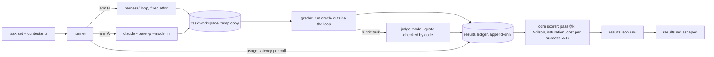

# STORY-004 — KeysBench: a monthly measurement of frontier models on software-engineering tasks

**As** the person who decides which AI coding contracts an engineering organisation renews
**I want** each month's frontier models measured on our kind of engineering work, with cost and latency
**so that** a contract decision rests on a measurement with its error bars, not on a public leaderboard.

## Scope

- A small task set (7 tasks) in the shape of test-and-measurement software work, each with an
  **executable oracle** (hidden tests or a numeric reference) and, where a test cannot see the
  property, a rubric scored by a judge whose evidence is checked by code.
- Two arms, never mixed in one ranked table:
  - **Arm B, bare model**: this repo's `harness/` with the same tools, the same prompt and a fixed
    `effort`, for Claude Fable 5.1, Opus 5.5, Sonnet 5.5 and Haiku 5.5.
  - **Arm A, product harness**: Claude Code (`claude --bare -p --model <id>`) on the same tasks with
    the same grader and the same fixed effort, for the same four models.
  - The report gives **A − B per model**: same model, different harness, so the difference is what
    the harness adds. That is the number a tool contract is about.
- Three attempts per (task, contestant) in both arms.
- A runner that records, a pure scorer, and a report (JSON raw, Markdown escaped) with pass rates,
  Wilson intervals, cost per solved task, and latency median and p95.
- Codex CLI and Cursor agent are written as a protocol (same task, same grader, same budget, cost
  from a metering proxy) with status `not run: CLI not available here`.

**Why AI-first, and where the code decides:** the contestants are models; the judge is a model only
for the one property a test cannot see (whether a code review found the planted defect). Everything
that can be checked by running code is checked by running code. The judge must quote the line it
relies on and the code checks the quote is in the artifact; the verdict is frozen once decided.

**What it is not:** a ranking. Seven tasks cannot separate frontier models that public benchmarks
place within two points of each other (a 50 % pass rate over 20 tasks has a ±20-point 95 % interval).
The deliverable is the **instrument**: tasks with oracles, graders that have been seen failing, a
cost ledger, and a report that says what it can and cannot conclude.

## Tasks

The domain tasks use a **fictitious instrument written for this benchmark** (a simulated SCPI power
meter with its own short manual). It is public-shaped (SCPI, IEEE 488.2, GUM) but not in any training
set, which is the cheapest defence against contamination. They are proxies for the real thing: the
benchmark worth running monthly needs tasks drawn from the organisation's own repositories.

| Id | Track | Task | Oracle |
|---|---|---|---|
| KB-01 | repo | Fix a regression in this repo, described as a bug report in prose (one seeded mutation) | the repo's own test suite on a temporary copy |
| KB-02 | domain | Write the driver function that configures the meter and reads one power value, from the manual alone | hidden tests against the simulator |
| KB-03 | domain | A driver times out on long reads; find and fix it (terminator and timeout handling) | a hidden test that reproduces the hang, plus the existing ones |
| KB-04 | domain | Uncertainty budget (GUM, first order) for a power reading from the manual's specification table | numeric reference with a tolerance |
| KB-05 | domain | A requester asks for a resolution the manual says the meter cannot give; the correct answer declines and quotes the limiting line | the structured answer says `not feasible` and quotes the manual line, checked by code |
| KB-06 | domain | Parse an IEEE 488.2 definite-length binary block of a trace and compute its RMS | reference value with a tolerance, plus malformed blocks that must be refused |
| KB-07 | domain | Review a small driver change with one planted defect | rubric scored by the judge; the quoted line must be in the diff |

## Flow



```text
 tasks + contestants ──► runner ──arm B──► harness/ loop (fixed effort) ──┐
                            │                                             ├─► task workspace (temp copy)
                            └──arm A──► claude --bare -p --model m ───────┘            │
                                                                                       ▼
                            usage + latency per call ──────────────────────► grader (outside the loop)
                                                                                       │ rubric task only
                                                                                       ▼
                                          results ledger (append-only) ◄── judge (quote checked by code)
                                                     │
                                                     ▼
                     core scorer: pass@k, pass^k, Wilson, saturation, cost per success, A - B
                                                     │
                                       results.json (raw) ──► results.md (escaped)
```

## Interface contract

```
keysbench run    --plan PATH --out DIR [--live] [--budget-usd N]   -> one ledger line per attempt
keysbench score  --ledger PATH --out DIR                           -> DIR/results.json, DIR/results.md
keysbench check-graders                                            -> each grader against base / reference / antipattern
--live      calls the models (needs ANTHROPIC_API_KEY); without it the runner replays recordings
--budget-usd  hard cap for the run; default 60
exit 0 on success; 2 on a refused command (unknown task, cap reached before the first attempt,
--live without a key), with the reason on stderr
```

Attempt line (ledger):

```
{ kind: "attempt", task_id, task_sha256, arm: "A" | "B", contestant: { model, effort, harness, harness_version },
  attempt: 1..k, outcome: "pass" | "fail" | "refused" | "error" | "budget_stopped",
  calls: [ { request_id, latency_s, usage: { input, cache_write_5m, cache_write_1h, cache_read, output, thinking } } ],
  cost_usd: number | null, cost_basis: "measured-usage" | "cli-usage" | "unpriced",
  latency_s, grader: { name, detail }, judge: { model, verdict, quote, quote_found } | null, at }
```

Results JSON:

```
{ benchmark: "keysbench-2026.10", generated_at, prices_checked_on, tasks: n,
  ranking: "none: n <= 8 tasks",
  cells: [ { task_id, arm, model, effort, attempts, passes, pass_at_1, pass_at_k, pass_hat_k,
             wilson_95: [lo, hi], cost_usd_total | null, cost_per_pass | null,
             latency_median_s, latency_p95_s, saturated } ],
  by_contestant: [ { arm, model, effort, pass_rate, wilson_95, cost_per_pass, latency_median_s, latency_p95_s } ],
  harness_delta: [ { model, a_minus_b, note } ],
  not_run: [ { contestant: "codex-cli", reason }, { contestant: "cursor-agent", reason } ] }
```

## Domain rules

- **DR-1 The unit is (harness, model, effort).** Every result row names all three, plus the harness
  version. A result is never attributed to "the model" alone.
- **DR-2 Effort is fixed and sent.** Every arm-B request carries the same explicit `effort`; it is
  recorded on the row. Comparing at each model's default would mix model and setting.
- **DR-3 Measured, not estimated.** Arm-B tokens come from the API's `usage` per call; cost is tokens
  times the price table checked on a stated date, split into uncached input, 5-minute cache write,
  1-hour cache write, cache read and output. A model with no price, or a price tier the table does not
  cover, gives `cost_usd: null` (`unpriced`), never 0. Arm-A cost is computed the same way from the
  per-call usage the CLI reports, labelled `cli-usage`; the CLI's own cost estimate is stored beside
  it as a cross-check.
- **DR-4 Latency is per call and is recorded.** Each model call's wall time and request id are stored
  when it is made. A replayed run reports the recorded latency, not the replay's near-zero time.
- **DR-5 A refusal is its own outcome.** A model that stops with `refusal` is `refused`, counted apart
  from `fail`.
- **DR-6 The grader runs outside the loop.** In arm B the contestant reads and writes files in its
  task workspace and cannot run code (AGENTS.md: no code-execution sandbox). The grader runs the oracle
  on a temporary copy after the attempt. In arm A, Claude Code may run commands in its workspace: that
  is part of what the product harness is, and part of what A − B measures.
- **DR-7 A grader is trusted once it has been seen failing.** Every task ships a base (unchanged), a
  reference solution and an antipattern (looks right, is wrong). `check-graders` must score them 0, 1
  and 0, and a canary that weakens a grader must turn the suite red.
- **DR-8 The judge only where a test cannot see, and its quote is checked.** Only KB-07 uses the judge.
  The judge receives the contestant's review anonymised (no model name), applies the rubric, and must
  quote the line its verdict rests on. If the quote is not in the diff, the verdict is `fail` with the
  reason `quote not found`. The judge model is never the contestant's model. The verdict is frozen,
  keyed on the task digest, the artifact digest, the rubric digest, the judge prompt digest and the
  judge model (DOCTRINE D-08): a re-score reads it, it does not ask again.
- **DR-9 Saturation.** A task every contestant in an arm passes on every attempt is `saturated` in that
  arm and left out of that arm's aggregates. It stays in the table, marked.
- **DR-10 No ranking below nine tasks.** With 8 tasks or fewer, the report states `ranking: none` and
  shows intervals; it never orders contestants by score or names a winner.
- **DR-11 A hard budget.** The runner keeps a running total from measured usage. It does not start an
  attempt whose worst case (its `max_tokens` at output price, plus its input) would cross the cap; the
  remaining cells are recorded as `budget_stopped`. Arm A passes the remaining budget to
  `--max-budget-usd`.
- **DR-12 CI never calls a model (DOCTRINE D-07).** Without `--live` the runner replays recordings; a
  request the recording never saw stops the run. Recordings hold no credential.
- **DR-13 Versioned.** The task set carries a version label (`keysbench-2026.10`) and every task its
  content digest. A row from a different task digest is never aggregated with this month's rows.

## Refused instructions

- None in this story's inputs. The STORY-002 requester note stays refused; KB-05 tests the same
  property from the other side: declining with evidence is the correct answer, not a failure.

## Limits

- Seven tasks, three attempts: the intervals are wide and the report says so. The instrument, not a
  verdict, is the deliverable.
- Domain tasks are public-shaped proxies on a fictitious instrument. The tasks that would show where
  an organisation's own knowledge is the advantage need its own repositories and specifications.
- One provider family. The judge is from the same family as the contestants; anonymisation, a judge
  model different from the contestant and a code-checked quote reduce that bias, they do not remove it.
- Arm A has no network isolation; its usage is what the CLI reports.
- Codex CLI and Cursor agent are not run here; the protocol is written so they can be.

## Acceptance Criteria

- [ ] Every attempt row names the harness, the model, the effort and the harness version (case: S4-01)
- [ ] Arm-B requests carry the fixed effort, and it is recorded on the row (case: S4-02)
- [ ] Cost is computed from measured usage per price component; an unpriced model or tier is null, never 0 (case: S4-03)
- [ ] Latency is recorded per call, and a replayed run reports the recorded latency (case: S4-04)
- [ ] A `refusal` stop is recorded as `refused`, apart from `fail` (case: S4-05)
- [ ] Each grader scores base 0, reference 1 and antipattern 0 (case: S4-06)
- [ ] The judge's verdict fails when its quote is not in the diff, and never runs on the contestant's own model (case: S4-07)
- [ ] A frozen judge verdict is reused on re-score and recomputed when any key input changes (case: S4-08)
- [ ] A task every contestant passes on every attempt is marked saturated and left out of the aggregates (case: S4-09)
- [ ] With 8 tasks or fewer the report states no ranking and orders nothing by score (case: S4-10)
- [ ] The runner stops before an attempt that could cross the budget and records the rest as budget_stopped (case: S4-11)
- [ ] Without `--live` the runner replays; an unrecorded request stops the run and no request reaches the network (case: S4-12)
- [ ] Wilson intervals, pass@k, pass^k, cost per pass and latency median/p95 match hand-computed values (case: S4-13)
- [ ] The report gives A − B per model and lists Codex and Cursor as not run, with the reason (case: S4-14)
- [ ] Rows from a different task digest are not aggregated together (case: S4-15)
- [ ] Contestant text in the Markdown report is escaped; the JSON keeps it raw (case: S4-16)
